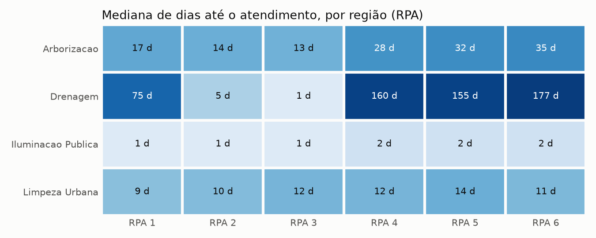
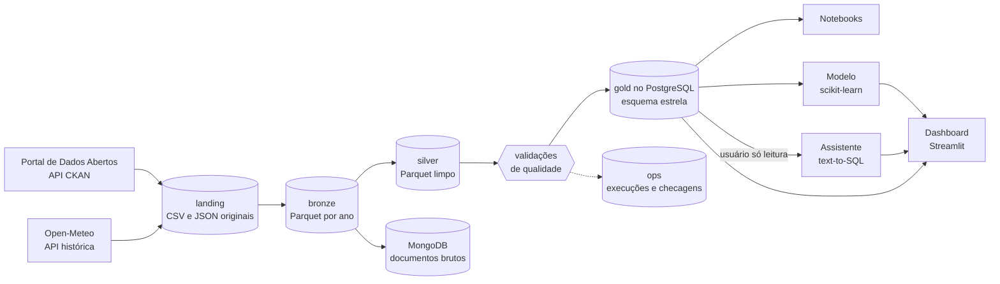
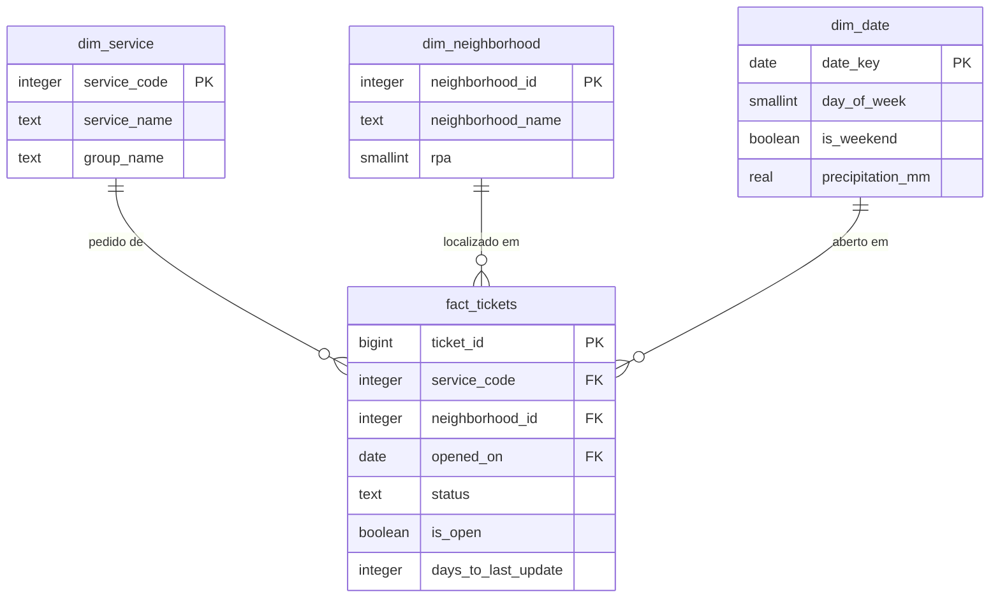

# Recife 156: o que os chamados de serviços urbanos revelam sobre a cidade

[](https://github.com/nogsposito/recife-156/actions/workflows/ci.yml)

Projeto de dados ponta a ponta sobre os chamados do 156 da Emlurb, a central em que moradores do Recife pedem conserto de iluminação, limpeza, poda de árvores, drenagem e pavimentação. Ele cruza os dados abertos da prefeitura com a chuva diária da cidade, trata tudo em camadas (bronze, silver e gold) com ingestão incremental e validações de qualidade, modela a camada final em esquema estrela no PostgreSQL, guarda o dado bruto no MongoDB, responde perguntas de gestão com SQL em notebooks, treina um modelo que prevê na abertura se um chamado será atendido em até 30 dias, usa NLP para unir 14 anos de descrições de serviço e entrega um dashboard com uma visão para cada público e um assistente que responde perguntas em português gerando SQL.


## Principais achados

Números dos 204.408 chamados abertos em 2024 e 2025. O resumo completo está em [docs/analises.md](docs/analises.md) e o passo a passo nos [notebooks](notebooks).

- Poucos serviços concentram a demanda: 10 de 108 somam 78% dos chamados, e "lâmpada apagada" sozinho é 35,6%.
- O tipo de serviço define a espera: iluminação tem mediana de 2 dias; drenagem, 47, e 78% dos pedidos de drenagem do período seguiam em aberto no fim de 2025.
- Em drenagem e arborização, a região também pesa: no mesmo serviço, as RPAs 4 a 6 (oeste, sudoeste e sul) esperam de 155 a 197 dias, contra 35 a 69 nas RPAs 1 a 3.
- A fila cresce: entre os chamados abertos desde janeiro de 2024, entrou mais do que saiu em todos os 24 meses, cerca de 1.900 por mês.
- Chuva forte aumenta a demanda, mas não explica a fila: nos dias seguintes a temporais, drenagem fica 13% e arborização 20% acima do normal.
- Dá para prever quem vai atrasar: o modelo acerta 89% dos alertas de "não será atendido em 30 dias", contra 83% da taxa histórica do serviço.
- Doze anos de histórico podem ser recuperados: um de-para semiautomático põe no grupo certo descrições antigas que somam mais de 90% dos chamados de 2012 a 2023.



## O problema

A prefeitura recebe mais de 100 mil chamados por ano no 156. Para quem gere esses serviços, as perguntas práticas são onde está a demanda, quanto tempo cada pedido leva, se alguma região espera mais, quanto da fila está parada, se a chuva antecipa picos e quais chamados recém-abertos devem atrasar. Os dados públicos permitem responder isso, mas chegam em CSVs anuais com formatos que mudam, sem identificador de chamado e com o mesmo pedido repetido em arquivos de anos diferentes.

## Os dados

| Fonte | Formato | Acesso |
|---|---|---|
| [Central de Atendimento de Serviços da Emlurb (156)](https://dados.recife.pe.gov.br/dataset/central-de-atendimento-de-servicos-da-emlurb-156), Portal de Dados Abertos do Recife | CSV por ano, licença ODbL | API CKAN para descobrir os arquivos, download direto |
| [Open-Meteo, API histórica](https://open-meteo.com/en/docs/historical-weather-api) | JSON com chuva e temperatura diárias, licença CC BY 4.0 | API REST sem chave |

O recorte padrão é 2024 e 2025. O notebook [01_data_cleaning](notebooks/01_data_cleaning.ipynb) mostra os problemas encontrados nos arquivos brutos e a decisão tomada em cada um: o arquivo de um ano traz chamados de anos anteriores, o mesmo chamado aparece em mais de um arquivo com situações diferentes, as grafias variam, há coordenadas fora do mapa e, até 2023, os códigos de serviço eram outros e os acentos foram apagados na origem. O schema real e as regras de limpeza estão em [docs/data_dictionary.md](docs/data_dictionary.md). A chuva vem de um modelo em grade, não de um pluviômetro: serve para comparar dias entre si, não para medir milímetros.

## Arquitetura



1. Ingestão incremental ([src/ingestion](src/ingestion)): baixa os arquivos do portal e o clima, com novas tentativas quando uma API falha, e grava cada ano na bronze em Parquet. Um manifesto registra a versão e o hash de cada arquivo; só o que mudou é baixado e regravado.
2. Silver ([src/layers](src/layers), [src/transform/cleaning.py](src/transform/cleaning.py)): tipa, padroniza textos, anula placeholders e coordenadas fora do Recife e mantém só a versão mais recente de cada chamado.
3. Qualidade ([src/quality/checks.py](src/quality/checks.py)): doze validações sobre a silver; uma falha grave interrompe a execução antes de tocar na gold.
4. Gold ([sql/schema.sql](sql/schema.sql), [src/db/load.py](src/db/load.py)): fato de chamados e dimensões de serviço, bairro e data (com o clima do dia), carregados com `COPY` e indexados em uma transação.
5. Dado bruto ([src/nosql](src/nosql)): cada linha dos arquivos anuais e cada resposta da API do clima, como chegaram, em documentos no MongoDB.
6. Análise ([notebooks](notebooks), [sql/analyses](sql/analyses)): perguntas de gestão, efeito da chuva, modelo e NLP, com dez consultas SQL versionadas e quatro hipóteses testadas.
7. Modelo ([src/ml](src/ml)), NLP ([src/nlp](src/nlp)) e assistente ([src/ai](src/ai)): detalhes nas seções abaixo.
8. Dashboard ([app](app)): cinco páginas em Streamlit e Plotly.

O fluxo de uma execução, o modelo completo e as camadas estão em [docs/architecture.md](docs/architecture.md); o papel de cada componente, por que foi escolhido e as alternativas, em [docs/explain.md](docs/explain.md); as decisões de arquitetura, nos ADRs sobre [PostgreSQL](docs/adr/0001-postgresql-como-banco-analitico.md), [camadas](docs/adr/0002-camadas-bronze-silver-gold.md), [Parquet](docs/adr/0003-parquet-para-bronze-e-silver.md) e [carga incremental](docs/adr/0004-carga-completa-da-gold.md).

### Modelo da camada gold



`is_open` e `days_to_last_update` são colunas geradas pelo PostgreSQL; para chamados atendidos, `days_to_last_update` é o tempo de resolução.

## Engenharia de dados

- Idempotência: rodar o pipeline duas vezes seguidas dá a mesma gold, e a segunda execução não baixa nada.
- Incremental: um ano só é baixado de novo quando o portal publica outra versão, e só é regravado quando o conteúdo também mudou. Se o portal estiver fora do ar e a bronze já existir, o pipeline segue com ela e registra um aviso.
- Validações: campos obrigatórios, datas coerentes e dentro do recorte, RPA válida, coordenadas dentro do Recife, um grupo por serviço e clima para todos os dias com chamado.
- Rastreabilidade: cada execução fica em `ops.pipeline_runs` e cada validação em `ops.quality_checks`.
- Atomicidade: a gold é recriada em uma única transação; uma falha no meio deixa a versão anterior intacta.

### SQL e otimização

As consultas usam CTEs, window functions (participação acumulada, `LAG` contra o mesmo mês do ano anterior, `RANK ... PARTITION BY`, soma acumulada da fila, médias móveis), percentis e agregações filtradas. `make benchmark` mede três consultas pesadas com `EXPLAIN ANALYZE`, sem e com os índices de [sql/indexes.sql](sql/indexes.sql), e grava os tempos em [docs/sql_optimization.md](docs/sql_optimization.md):

| Consulta | Sem índice | Com índice |
|---|---|---|
| Fila em aberto de um bairro, mais antigos primeiro | 35,8 ms | 0,3 ms |
| Médias móveis de 7 e 28 dias de um serviço | 33,0 ms | 3,0 ms |
| Chamados por dia e grupo com a chuva do dia | 345,5 ms | 315,4 ms |

O índice parcial só dos chamados em aberto é o que mais ganha. Na terceira consulta, que precisa contar a tabela inteira, índice não ajuda; o que funcionou foi reescrevê-la para agregar antes de juntar com o calendário, cerca de 2,5 vezes mais rápida com o mesmo resultado.

### Dado bruto no MongoDB

O PostgreSQL guarda o dado tratado; o MongoDB guarda o dado como chegou. Cada linha dos arquivos anuais vira um documento com os nomes de coluna e os textos originais, e cada resposta do Open-Meteo é guardada inteira, com metadados e listas diárias aninhadas. Isso permite auditar e investigar a fonte sem esquema fixo, antes de mudar a limpeza, e acompanha a mesma carga incremental da bronze. Três agregações de exemplo, geradas a cada carga em [docs/mongo_results.md](docs/mongo_results.md): o mesmo chamado em dois arquivos anuais e como a situação mudou entre eles, a parcela de linhas com coordenadas por arquivo e a chuva por mês calculada direto do JSON aninhado.

## Modelo de previsão

Objetivo: saber, quando o chamado é aberto, se ele deve ser atendido em até 30 dias. A central ganha um prazo realista para informar ao cidadão, e a supervisão, uma lista dos chamados que devem atrasar.

O alvo é "atendido em até 30 dias, sim ou não", e não "quantos dias": 23% dos chamados ainda estão abertos e não têm tempo de resolução, e um chamado aberto há mais de 30 dias é um "não" conhecido. A validação é temporal: treino com chamados abertos até 31/05/2025, intervalo de 30 dias, teste com os abertos de 01/07 a 01/12/2025.

| Modelo | AUC | Brier | Precisão do alerta | Recall do alerta |
|---|---|---|---|---|
| Taxa geral do treino | 0,500 | 0,222 | - | - |
| Histórico do serviço | 0,954 | 0,073 | 83,4% | 86,8% |
| Gradient boosting (scikit-learn) | 0,960 | 0,067 | 89,2% | 83,6% |

O tipo de serviço praticamente decide o prazo, então a taxa histórica de cada serviço já é uma régua muito forte. O modelo fica acima dela em todas as métricas de probabilidade e acerta mais quando alerta um atraso. O ganho vem quase todo do bairro e aparece onde o prazo é incerto: o erro cai 38% em arborização e 25% em drenagem. Detalhes, calibração e limitações no [notebook 04](notebooks/04_resolution_model.ipynb) e em [docs/ml_results.md](docs/ml_results.md).

## IA aplicada

### NLP: unir 14 anos de descrições de serviço

Os dados não têm texto livre do cidadão; o único texto é a descrição do serviço, de uma lista que mudou em 2024 e que até 2023 perdia as letras acentuadas ("MANUTENO EM LMPADA APAGADA"). O [notebook 05](notebooks/05_service_text.ipynb) treina com as 94 descrições de 2024 e 2025 e testa em 77 descrições de 2012 a 2023 que não existem hoje:

| Método (texto reparado) | Acurácia | Chamados no grupo certo | F1 macro |
|---|---|---|---|
| N-gramas de caracteres (TF-IDF) + regressão logística | 0,766 | 0,973 | 0,614 |
| Embeddings (transformer multilíngue) + regressão logística | 0,597 | 0,907 | 0,447 |
| Embeddings: serviço atual mais parecido | 0,688 | 0,941 | 0,507 |

Para dizer o grupo, o baseline de caracteres ganha do transformer: os textos são curtos, abreviados e com grafias quebradas. Os embeddings servem para sugerir o serviço equivalente, desde que as palavras quebradas sejam antes restauradas pelo vocabulário atual ("MANUTENO" vira "MANUTENCAO"); acima de 0,9 de similaridade, todas as sugestões acertam o grupo. O de-para sugerido está em [docs/service_mapping.csv](docs/service_mapping.csv).

### Assistente "Pergunte aos dados"

A pessoa escreve uma pergunta ("quais os 5 bairros com mais chamados de drenagem em aberto?") e o Claude (Opus 5.5, pela API da Anthropic) escreve a SQL, consulta o banco e responde em português, mostrando cada consulta usada e o resultado. O modelo recebe no prompt as tabelas e colunas da gold, os valores das categorias e o significado de cada campo, e pode rodar algumas consultas seguidas para corrigir os próprios erros.

A segurança é em camadas, e cada uma funciona mesmo que a anterior falhe:

1. Validação da SQL antes de executar ([src/ai/sql_guard.py](src/ai/sql_guard.py)): um único comando, só `SELECT`, só as tabelas da gold, sem funções perigosas e com limite de 200 linhas.
2. Usuário de banco `assistant_readonly`, que só lê essas tabelas e não enxerga o schema `ops`.
3. Transação somente leitura e tempo máximo de 10 segundos por consulta.

Sem chave de API, a página avisa como habilitar o assistente e continua permitindo rodar uma SQL à mão, com as mesmas proteções. Para habilitar, coloque `ANTHROPIC_API_KEY` no arquivo `.env`.

## Dashboard

Cada página responde às perguntas de um público e tem filtros por grupo de serviço e região quando fazem sentido.

| Página | Para quem | O que mostra |
|---|---|---|
| Operacional | Quem coordena a central e as equipes | O que chegou nos últimos dias, tamanho e idade da fila, bairros e serviços com mais pendências |
| Gerencial | Gestão da Emlurb | Volume, taxa de atendimento e tempos por grupo, abertos e atendidos por mês, tempo por região |
| Estratégico | Direção | Variação entre anos, sazonalidade ao lado da chuva, efeito da chuva forte por serviço |
| Previsões | Quem prioriza a fila | Atrasos esperados, chamados recentes com menor chance de atendimento a tempo, simulador e avaliação do modelo |
| Pergunte aos dados | Qualquer pessoa | O assistente, com a SQL sempre visível |


Mais capturas: [gerencial](docs/img/dashboard_managerial.png), [estratégica](docs/img/dashboard_strategic.png) e [assistente](docs/img/dashboard_assistant.png).

## Como rodar

Pré-requisito: Docker com Docker Compose. O `make` é opcional e só encurta os comandos.

```bash
git clone https://github.com/nogsposito/recife-156.git
cd recife-156
docker compose up --build
```

O Compose sobe o PostgreSQL e o MongoDB, roda o pipeline (ingestão, silver, validações e gold), treina o modelo, carrega os documentos brutos e abre o dashboard em `http://localhost:8501`. A primeira execução leva alguns minutos (build da imagem e download de cerca de 40 MB de dados); as seguintes, uns dois minutos, sem novos downloads. O PostgreSQL fica em `localhost:5433` e o MongoDB em `localhost:27018` (credenciais em [.env.example](.env.example)).

| Comando | O que faz |
|---|---|
| `make pipeline` | Ingestão do que mudou, silver, validações e gold |
| `make refresh` | Igual a `pipeline`, mas baixa e reconstrói todas as camadas do zero |
| `make ingest` / `make load` | Só a ingestão para a bronze / só silver, validações e gold |
| `make train` | Treina o modelo de 30 dias e atualiza `docs/ml_results.md` |
| `make mongo` | Carrega os documentos brutos e atualiza `docs/mongo_results.md` |
| `make nlp` | NLP das descrições de serviço (baixa 2012 a 2023 e o modelo de embeddings na primeira vez) |
| `make benchmark` | Mede as consultas pesadas com e sem índices |
| `make dashboard` | Abre o dashboard com os dados já carregados |
| `make notebooks` / `make jupyter` | Reexecuta os notebooks / abre o JupyterLab em `http://localhost:8888` |
| `make test` / `make lint` | Testes (pytest) / estilo e formatação (ruff) |
| `make psql` | Terminal SQL no banco |
| `make down` / `make clean` | Para os containers / apaga também os bancos e as camadas de arquivos |

Para mudar o recorte, ajuste `YEARS` no `.env` (por exemplo `YEARS=2024,2025,2026`). Anos anteriores a 2024 são recusados com uma mensagem explicando o motivo. Tudo roda em containers; para rodar fora do Docker, com Python 3.11 ou mais recente, use `pip install -e ".[dev,notebooks,nlp]"`.

## Testes e integração contínua

Os 46 testes em [tests](tests) cobrem as regras de limpeza, a deduplicação entre arquivos anuais, a escolha do arquivo no portal, a ingestão incremental, as validações de qualidade, o esquema estrela, o clima, as features do modelo (alvo, demanda sem olhar o futuro, divisão temporal), o NLP, a validação de SQL e o laço do assistente com um cliente simulado, e a conversão para documentos do MongoDB. Nenhum precisa de banco, internet ou chave de API. O workflow [.github/workflows/ci.yml](.github/workflows/ci.yml) roda lint, formatação e testes em todo pull request.

## Estrutura do repositório

```
src/
  pipeline.py            orquestra ingestão, silver, validações e gold
  ingestion/             APIs do portal e do clima, ingestão incremental, novas tentativas
  layers/                bronze (com manifesto) e silver
  transform/             limpeza e montagem do esquema estrela
  quality/               validações de qualidade
  db/                    carga da gold, usuário somente leitura e registro das execuções
  nosql/                 documentos brutos e agregações no MongoDB
  ml/                    features, treino com validação temporal e previsão
  nlp/                   descrições de serviço: reparo, embeddings e de-para
  ai/                    assistente text-to-SQL e validação de SQL
  analysis/, dashboard/  gráficos, efeito da chuva e leitura de dados do dashboard
  benchmark.py           EXPLAIN ANALYZE com e sem índices
app/                     dashboard Streamlit
notebooks/               limpeza, análise de negócio, chuva, modelo e NLP
sql/                     esquema, índices, permissões, consultas analíticas e de benchmark
tests/                   testes automatizados
docs/                    resumo, estudo de caso, arquitetura, ADRs, componentes e resultados
```

## Decisões e limitações

- Sem identificador de chamado, o mesmo chamado em anos diferentes é reconhecido por serviço, endereço, bairro e data de abertura, uma aproximação: dois pedidos iguais no mesmo dia e endereço viram dois chamados.
- A situação de cada chamado é a do fim do último ano carregado, e a data de atendimento é a da última mudança de situação, que depende de como cada equipe registra o andamento. As medianas de tempo subestimam a espera onde a fila é grande.
- Silver e gold são recalculadas por completo a cada execução: sem identificador estável, uma carga incremental da gold mudaria a identidade dos chamados.
- Pouco mais da metade das linhas não tem coordenadas, então as análises regionais usam bairro e RPA.
- A chuva vem de um único ponto de um modelo em grade, que subestima volumes; dados de pluviômetro por bairro dariam um teste mais forte.
- O dashboard mostra a situação na data mais recente dos dados abertos (31/12/2025), não em tempo real. Não há deploy público, porque o dashboard depende dos bancos; a demonstração está no GIF acima.
- O modelo não conhece capacidade das equipes, contratos ou mutirões, que provavelmente explicam boa parte da diferença entre regiões.
- O NLP trabalha sobre uma lista fechada de descrições, com treino e teste pequenos; o de-para precisa de revisão humana abaixo de 0,9 de similaridade.
- O assistente depende de uma chave paga da API da Anthropic e pode interpretar mal uma pergunta; por isso a SQL sempre aparece. As proteções impedem que ele altere dados, não que responda errado.

## Como usei IA no desenvolvimento

O projeto foi construído com o Claude Code, assistente de programação da Anthropic, trabalhando como par de programação. Eu defini o objetivo, as seis etapas, a stack, o que cada etapa precisava entregar e as regras de trabalho: código em inglês, comentários só onde não é óbvio, nenhum número sem execução real e resultados fracos relatados como fracos. O Claude Code escreveu a maior parte do código, das consultas e dos textos, rodou o pipeline, os testes e os notebooks e trouxe os resultados de cada etapa, que foi entregue como um pull request para revisão.

O que funcionou bem foi exigir verificação em vez de confiança: cada achado foi conferido contra o dado, e cada etapa foi testada do zero com `docker compose up`. Foi assim que apareceram erros que teriam passado despercebidos, como uma regra de duplicatas que descartava 429 chamados por engano, um container do dashboard rodando com uma imagem antiga, palavras quebradas que derrubavam o NLP na descrição mais importante e chamadas de API que travavam a execução. Cada um foi corrigido e registrado.

O que exige cuidado: a IA escreve rápido e com confiança, então os pontos de decisão (escopo, o que conta como resultado bom, quando parar de refinar) ficam com quem conduz o projeto, e os textos de conclusão precisam ser lidos com o mesmo rigor que o código. O assistente text-to-SQL do dashboard segue o mesmo princípio: ele usa um modelo de linguagem, mas sempre mostra a SQL que rodou.

## Documentação

- [Resumo das análises](docs/analises.md) e [estudo de caso](docs/case-study.md)
- [Arquitetura](docs/architecture.md), [componentes e alternativas](docs/explain.md) e [ADRs](docs/adr)
- [Dicionário de dados](docs/data_dictionary.md)
- Resultados gerados: [otimização SQL](docs/sql_optimization.md), [modelo](docs/ml_results.md), [NLP](docs/nlp_results.md) e [MongoDB](docs/mongo_results.md)

## Tecnologias

Python 3.12, pandas, pyarrow (Parquet), requests, SQLAlchemy e psycopg 3, PostgreSQL 16, MongoDB 7 e pymongo, Streamlit, Plotly, scikit-learn, SciPy, sentence-transformers (PyTorch), API da Anthropic, sqlglot, Jupyter, matplotlib, pytest, ruff, GitHub Actions, Docker Compose e Make.

## Licença

Código sob licença MIT. Os dados são da Prefeitura do Recife, publicados sob a Open Database License (ODbL).
