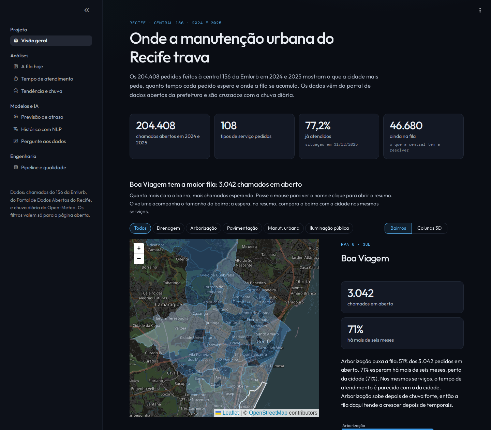
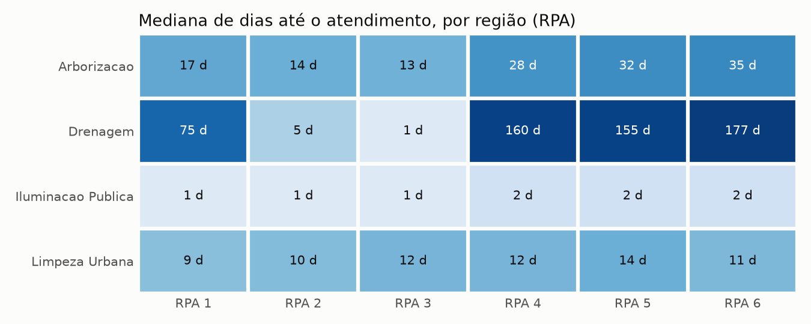
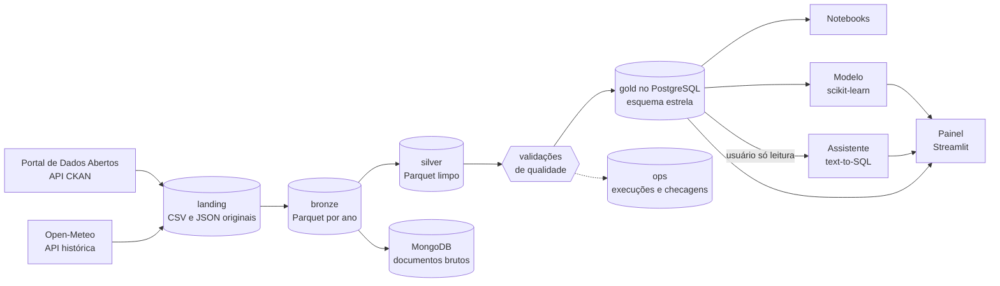
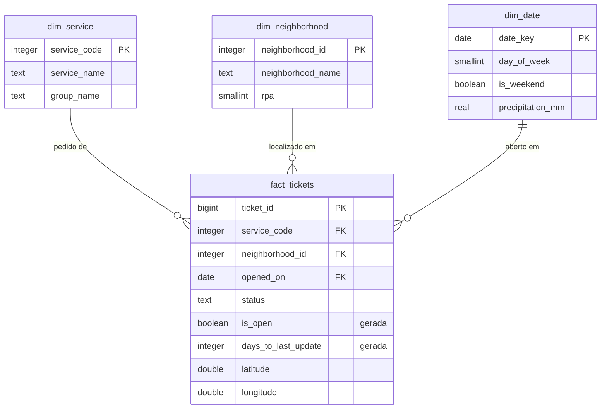
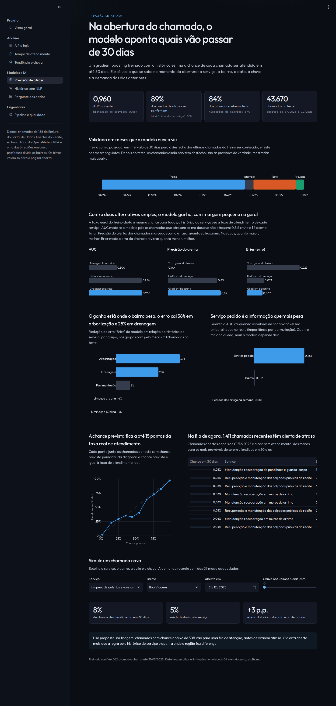

# Recife 156: o que os chamados de serviços urbanos revelam sobre a cidade

[](https://github.com/nogsposito/recife-156/actions/workflows/ci.yml)

O projeto analisa os chamados registrados no 156 da Emlurb, canal pelo qual os moradores do Recife solicitam serviços como reparos na iluminação pública, limpeza urbana, poda de árvores, drenagem e pavimentação. A ideia é transformar esses registros em informações que ajudem a entender melhor os problemas da cidade, identificar padrões nos atendimentos e prever quais solicitações têm maior chance de serem resolvidas em até 30 dias.

Para isso, reuni dados abertos da Prefeitura do Recife e informações sobre a chuva na cidade. Organizei e validei esses dados em diferentes etapas, armazenando tanto os registros originais quanto as informações já tratadas para análise. A partir daí, construí um banco de dados estruturado, fiz análises com SQL, desenvolvi um modelo de machine learning para prever o prazo de atendimento e usei técnicas de processamento de linguagem natural (NLP) para padronizar descrições de serviços registradas ao longo de 14 anos.

Por fim, o projeto disponibiliza dashboards com informações direcionadas a diferentes públicos e um assistente inteligente que permite fazer perguntas sobre os dados em português e obter respostas por meio de consultas SQL.

Painel: [recife-156.streamlit.app](https://recife-156.streamlit.app)

[](https://recife-156.streamlit.app)

## Termos usados aqui

| Termo | O que é |
|---|---|
| 156 | Canal de atendimento da Prefeitura do Recife, por onde os moradores pedem serviços urbanos |
| Emlurb | Empresa de Manutenção e Limpeza Urbana do Recife, responsável por iluminação, limpeza, poda, drenagem e pavimentação |
| Chamado | Um pedido registrado no 156. Fica em aberto até ser marcado como atendido |
| Fila | Os chamados ainda em aberto na data mais recente dos dados, 31/12/2025 |
| RPA | Região Político-Administrativa. A prefeitura agrupa os 94 bairros em 6 regiões: 1 Centro, 2 Norte, 3 Noroeste, 4 Oeste, 5 Sudoeste e 6 Sul |
| Mediana | O valor do meio: metade dos chamados levou menos que isso. É usada no lugar da média porque poucos chamados muito longos distorceriam a média |

## O problema

A prefeitura recebe mais de 100 mil chamados por ano. Para quem acompanha esses serviços, as perguntas práticas são estas:

- Quais serviços concentram a maior parte dos pedidos?
- Quanto tempo cada tipo de chamado leva para ser atendido?
- Alguma região da cidade espera mais que as outras?
- A fila está crescendo ou diminuindo?
- A chuva aumenta os pedidos de drenagem e de poda?
- Dá para saber, já na abertura, quais chamados correm risco de passar de 30 dias?

Os dados abertos permitem responder, mas não chegam prontos. São CSVs anuais cujo formato muda de um ano para outro, sem identificador de chamado, com o mesmo pedido repetido em arquivos de anos diferentes e com descrições de serviço que mudaram de catálogo. Boa parte do trabalho foi entender essas limitações e decidir como tratá-las.

## Principais achados

São 204.408 chamados abertos em 2024 e 2025. O resumo completo está em [docs/analises.md](docs/analises.md), e o passo a passo, nos [notebooks](notebooks).

- A demanda é concentrada. 10 dos 108 serviços somam 78% dos chamados, e "lâmpada apagada" sozinho é 35,6%.
- O tipo de serviço decide a espera. A mediana é de 2 dias em iluminação e 47 em drenagem, e 78% dos pedidos de drenagem do período seguiam em aberto no fim de 2025.
- Em drenagem e arborização, a região também pesa. No mesmo serviço (limpeza de galerias e valetas), as RPAs 4, 5 e 6 (Oeste, Sudoeste e Sul) esperam de 155 a 197 dias, contra 35 a 69 nas RPAs 1 a 3. Em iluminação e limpeza urbana o tempo é parecido em toda a cidade.
- A fila cresce. Entre os chamados abertos desde janeiro de 2024, entrou mais do que saiu em todos os 24 meses, cerca de 1.900 por mês.
- Chuva forte aumenta a demanda, mas não explica a fila. Nos dias seguintes a temporais, drenagem fica 13% e arborização 20% acima do normal, o que equivale a poucos chamados por dia.
- Dá para antecipar parte dos atrasos. Dos chamados que o modelo marca como "não será atendido em 30 dias", 89,2% de fato não são, contra 83,4% quando a regra é a taxa histórica do serviço.
- O histórico antigo pode ser reaproveitado. Um de-para semiautomático põe no grupo certo descrições de 2012 a 2023 que somam mais de 90% dos chamados desse período.



## Fontes e preparação dos dados

| Fonte | O que traz | Acesso |
|---|---|---|
| [Central de Atendimento de Serviços da Emlurb (156)](https://dados.recife.pe.gov.br/dataset/central-de-atendimento-de-servicos-da-emlurb-156), Portal de Dados Abertos do Recife | Chamados em CSV por ano, licença ODbL | API CKAN para achar os arquivos, download direto |
| [Bairros do Recife](https://dados.recife.pe.gov.br/dataset/area-urbana), mesmo portal | Contorno oficial dos 94 bairros em GeoJSON | Baixado uma vez e simplificado em [app/assets](app/assets) |
| [Open-Meteo, API histórica](https://open-meteo.com/en/docs/historical-weather-api) | Chuva e temperatura diárias em JSON, licença CC BY 4.0 | API REST sem chave |

Ao explorar os arquivos ([notebook 01](notebooks/01_data_cleaning.ipynb)) encontrei problemas que precisavam de uma decisão antes de qualquer análise. Um arquivo anual traz chamados de anos anteriores, e o mesmo chamado aparece em mais de um arquivo com situações diferentes. As grafias variam, há campos preenchidos com valores que significam "sem informação" e coordenadas fora do Recife. E até 2023 os códigos de serviço eram outros e os acentos foram apagados na origem.

Como a fonte não tem identificador de chamado, a deduplicação usa serviço, endereço, bairro e data de abertura, e mantém a versão do arquivo mais recente. A regra tem um custo conhecido: dois pedidos diferentes para o mesmo serviço, endereço e dia viram um só. Uma primeira versão que tratava "SN", "0" e "00" como o mesmo número descartava 429 chamados legítimos, e foi corrigida para remover só linhas idênticas.

A chuva vem de um modelo meteorológico em grade, não de pluviômetros nos bairros. Ela serve para comparar dias mais e menos chuvosos, não para medir milímetros por região. O schema e as regras de limpeza estão em [docs/data_dictionary.md](docs/data_dictionary.md).

## Arquitetura



### Camadas

O pipeline segue o padrão medallion. A landing guarda os arquivos exatamente como vieram. A bronze os converte para Parquet por ano, sem alterar o conteúdo, e um manifesto registra a versão publicada no portal e o hash de cada arquivo. A silver tipa, padroniza e deduplica. A gold é o banco analítico.

A ingestão é incremental: um arquivo só é baixado de novo quando o portal publica outra versão, e só é regravado quando o conteúdo muda de fato (mesmo hash, nada é reprocessado). Se o portal estiver fora do ar e já houver cópia local, a execução segue com ela e registra um aviso. Parquet foi escolhido por ser colunar e tipado, o que deixa a leitura analítica rápida e preserva os tipos entre as camadas ([ADR 0003](docs/adr/0003-parquet-para-bronze-e-silver.md)).

### Validação e qualidade

Antes de carregar a gold, doze checagens rodam sobre a silver: campos obrigatórios, coerência das datas, RPA entre 1 e 6, coordenadas dentro do Recife, um grupo por serviço e chuva para todos os dias com chamado, entre outras. Dez delas bloqueiam: se uma falha, a carga para antes de tocar no banco. Cada execução fica registrada em `ops.pipeline_runs`, o resultado de cada checagem em `ops.quality_checks` e a versão de cada fonte lida em `ops.source_versions`.

A gold é recriada inteira numa única transação; se algo falhar no meio, a versão anterior continua valendo. Sem identificador estável na fonte, uma carga incremental poderia mudar a identidade atribuída aos chamados entre execuções ([ADR 0004](docs/adr/0004-carga-completa-da-gold.md)).

### Modelo dimensional

A gold é um esquema estrela: a tabela fato `fact_tickets`, com um chamado por linha, e as dimensões de serviço, bairro e data. A dimensão de data carrega a chuva do dia, então cruzar demanda e clima é um join, não uma reconstrução. As colunas `is_open` e `days_to_last_update` são geradas pelo próprio PostgreSQL a partir da situação e das datas, o que garante a mesma definição em todas as consultas.



### MongoDB para o dado bruto

O PostgreSQL guarda o dado tratado. O MongoDB guarda os registros brutos como documentos, com os nomes de coluna e os textos originais de cada arquivo, além das respostas completas da API de clima. Isso permite investigar uma inconsistência na origem sem depender do formato relacional da gold. As agregações de exemplo (chamados repetidos entre arquivos, cobertura de coordenadas por ano, chuva mensal calculada dos documentos) estão em [docs/mongo_results.md](docs/mongo_results.md).

## Consultas SQL

As dez consultas em [sql/analyses](sql/analyses) respondem às perguntas de gestão e alimentam os indicadores do painel. Usam CTEs, window functions (participação acumulada, `LAG` contra o mesmo mês do ano anterior, `RANK ... PARTITION BY`, soma acumulada, médias móveis de 7 e 28 dias), percentis e agregações filtradas. Duas delas mostram bem o estilo.

A evolução da fila ([10_backlog_evolution.sql](sql/analyses/10_backlog_evolution.sql)) conta entradas e saídas por mês e acumula a diferença com uma window function. Contar só os chamados abertos desde o início do recorte faz a fila começar em zero, sem herdar pendências que os arquivos não trazem:

```sql
SELECT
    month,
    opened,
    resolved,
    SUM(opened - resolved) OVER (ORDER BY month) AS open_at_month_end,
    ROUND(AVG(opened - resolved) OVER (
        ORDER BY month ROWS BETWEEN 2 PRECEDING AND CURRENT ROW
    )) AS net_change_3m_avg
FROM monthly
ORDER BY month;
```

A série de chamados por dia e grupo ao lado da chuva ([09_daily_tickets_and_rain.sql](sql/analyses/09_daily_tickets_and_rain.sql)) agrega os chamados antes de cruzar com o calendário. A grade de todos os dias com todos os grupos é necessária para que dia sem chamado entre como zero na comparação estatística:

```sql
WITH daily_counts AS (
    SELECT t.opened_on, s.group_name, COUNT(*) AS tickets
    FROM fact_tickets AS t
    JOIN dim_service AS s USING (service_code)
    GROUP BY t.opened_on, s.group_name
)
SELECT c.date_key AS day, c.precipitation_mm AS rain_mm, g.group_name,
       COALESCE(dc.tickets, 0) AS tickets
FROM calendar AS c
CROSS JOIN service_groups AS g
LEFT JOIN daily_counts AS dc
    ON dc.opened_on = c.date_key AND dc.group_name = g.group_name;
```

### Otimização

`make benchmark` roda as consultas mais pesadas com `EXPLAIN (ANALYZE, BUFFERS)`, sem e com os índices de [sql/indexes.sql](sql/indexes.sql), e guarda a mediana de 15 execuções em [docs/sql_optimization.md](docs/sql_optimization.md).

| Consulta | Sem índice | Com índice |
|---|---|---|
| Fila em aberto de um bairro, mais antigos primeiro | 38,6 ms | 0,2 ms |
| Médias móveis de 7 e 28 dias de um serviço | 37,9 ms | 3,5 ms |
| Chamados por dia e grupo com a chuva do dia | 337,1 ms | 332,7 ms |

O maior ganho vem de um índice parcial, que guarda só os chamados em aberto (cerca de um quarto da tabela) já ordenados por bairro e data, exatamente o que a consulta da fila de um bairro lê:

```sql
CREATE INDEX idx_fact_tickets_open_by_neighborhood
    ON fact_tickets (neighborhood_id, opened_on)
    WHERE is_open;
```

A consulta de chuva quase não muda com índice, porque precisa contar a tabela inteira. Nela o que funcionou foi a reescrita acima: a primeira versão juntava calendário e chamados antes de agregar, e levava 822 ms; agregando primeiro, caiu para 333 ms, com o mesmo resultado.

## Modelo de previsão de atraso

### Formulação

O modelo estima, no momento da abertura, a chance de um chamado ser atendido em até 30 dias. Na triagem, os chamados com chance abaixo de 50% iriam para uma fila de atenção antes de virarem atraso.

Tratei o problema como classificação binária em vez de regressão do número de dias. Cerca de 23% dos chamados ainda estavam em aberto, sem tempo final conhecido, e uma regressão teria de descartá-los ou inventar uma data de resolução. Já um chamado aberto há mais de 30 dias sem atendimento tem desfecho conhecido para este alvo: não foi atendido a tempo. O alvo é 1 para atendido em até 30 dias e 0 para o resto, e só entram chamados abertos há pelo menos 30 dias antes da data de referência.

### Algoritmo e variáveis

O modelo é um `HistGradientBoostingClassifier` do scikit-learn (300 iterações, taxa de aprendizado 0,08, até 31 folhas por árvore, regularização L2 de 1,0). Escolhi gradient boosting por histogramas porque os dados são tabulares, com variáveis categóricas de muitos níveis (108 serviços, 94 bairros) que ele trata de forma nativa, sem one-hot, e porque ele lida com valores ausentes (bairro em branco) e com interações não lineares, como "drenagem na RPA 6", sem engenharia manual.

As variáveis usam só o que se sabe na hora da abertura:

| Variável | O que é |
|---|---|
| `service_name`, `group_name` | Serviço pedido e seu grupo (categóricas) |
| `neighborhood_name`, `rpa` | Bairro e região (categóricas) |
| `month`, `day_of_week`, `is_weekend` | Calendário da abertura |
| `rain_3d_mm` | Chuva do dia e dos dois anteriores |
| `service_demand_7d` | Chamados do mesmo serviço nos 7 dias antes da abertura |
| `neighborhood_demand_30d` | Chamados do mesmo bairro nos 30 dias antes da abertura |

As contagens de demanda olham só para os dias anteriores ao da abertura, e há um teste garantindo isso, para o modelo não aprender com informação do futuro.

### Validação temporal

A divisão é por data, não aleatória: treino com chamados abertos até 31/05/2025 (146.062) e teste com os abertos de 01/07 a 01/12/2025 (43.670). O intervalo de 30 dias entre os dois existe porque o desfecho dos últimos chamados do treino só fica conhecido 30 dias depois. Sem esse intervalo, o rótulo do treino dependeria de acontecimentos do período de teste. Uma divisão aleatória misturaria meses e daria uma nota melhor do que a do uso real, que é prever chamados futuros.

O modelo é comparado com duas referências: a taxa geral do treino, que dá a mesma chance a todos, e a taxa histórica de cada serviço, uma regra simples que já explica boa parte da variação.

| Modelo | AUC | Brier | Acurácia | Precisão do alerta | Recall do alerta |
|---|---|---|---|---|---|
| Taxa geral do treino | 0,500 | 0,222 | 66,7% | - | - |
| Histórico do serviço | 0,954 | 0,073 | 89,8% | 83,4% | 86,8% |
| Gradient boosting | 0,960 | 0,067 | 91,2% | 89,2% | 83,6% |

AUC mede se o modelo põe os chamados que atrasam acima dos que não atrasam (0,5 é chute, 1 é acerto total). Brier mede o erro da probabilidade prevista, e quanto menor, melhor. A precisão do alerta diz quantos dos chamados marcados como atraso de fato atrasaram; o recall, quantos dos atrasos foram marcados.

### O que o modelo aprendeu

A importância por permutação (quanto a AUC cai quando uma variável é embaralhada no teste) mostra que o serviço é quase tudo: 0,458, contra 0,013 do bairro e perto de zero para as demais, chuva incluída. O ganho sobre o histórico do serviço é pequeno no geral e concentrado onde a região pesa: o erro (Brier) cai 38% em arborização e 25% em drenagem. Por isso a precisão do alerta sobe de 83,4% para 89,2%, enquanto a AUC muda pouco.

A calibração foi conferida em dez faixas de chance prevista, e a taxa real de atendimento fica a até 15 pontos percentuais da prevista. O modelo não conhece capacidade das equipes, contratos ou mutirões, que provavelmente explicam parte da diferença entre regiões, então serve para priorizar, não para explicar causas. Detalhes em [notebook 04](notebooks/04_resolution_model.ipynb) e [docs/ml_results.md](docs/ml_results.md).

## NLP: 14 anos de descrições de serviço

Até 2023 o catálogo de serviços era outro, e a exportação apagou as letras acentuadas: "MANUTENO EM LMPADA APAGADA" é a manutenção de lâmpada de hoje. O objetivo foi ligar cada descrição antiga a um grupo atual, para estender as análises de 2 para 14 anos.

No [notebook 05](notebooks/05_service_text.ipynb), os métodos aprendem com as 94 descrições de 2024 e 2025 e são testados nas 77 descrições de 2012 a 2023 que não existem no catálogo atual. Os números abaixo são com o texto reparado:

| Método | Acurácia | Chamados no grupo certo | F1 macro |
|---|---|---|---|
| N-gramas de caracteres (TF-IDF) + regressão logística | 0,766 | 0,973 | 0,614 |
| Embeddings (transformer multilíngue) + regressão logística | 0,597 | 0,907 | 0,447 |
| Embeddings: serviço atual mais parecido | 0,688 | 0,941 | 0,507 |

Para dizer o grupo, n-gramas de 2 a 4 caracteres ganham do transformer (`paraphrase-multilingual-MiniLM-L12-v2`). As descrições são curtas, abreviadas e com letras faltando, e pedaços de palavra sobrevivem a isso melhor que o sentido da frase. Os embeddings servem para outra coisa: sugerir o serviço atual equivalente. Para isso, primeiro reparo as palavras quebradas com o vocabulário atual ("MANUTENO" vira "MANUTENCAO" quando a palavra completa existe no catálogo), o que leva a busca por similaridade de 60% para 94% de chamados no grupo certo. Acima de 0,9 de similaridade, todas as sugestões acertaram o grupo; abaixo disso, a revisão manual de poucas descrições resolve o resto. O de-para está em [docs/service_mapping.csv](docs/service_mapping.csv).

## Assistente "Pergunte aos dados"

A pessoa escreve uma pergunta em português, como "quais os 5 bairros com mais chamados de drenagem em aberto?". Um modelo de linguagem (Claude Haiku 5.5, pelo OpenRouter) recebe as tabelas e colunas da gold, os valores das categorias e o significado de cada campo, escreve a SQL, vê o resultado e responde. Ele pode rodar algumas consultas seguidas para corrigir os próprios erros, e cada consulta aparece abaixo da resposta. Trocar de modelo é mudar `OPENROUTER_MODEL`.

Como o modelo escreve SQL, a segurança não depende dele. São três barreiras, cada uma valendo mesmo que a anterior falhe:

1. Validação da SQL antes de executar ([src/ai/sql_guard.py](src/ai/sql_guard.py)), com o parser do sqlglot: um único comando, só `SELECT`, só tabelas da gold, sem funções perigosas e com limite de 200 linhas.
2. Usuário de banco `assistant_readonly`, que só lê essas tabelas e não enxerga o schema `ops`.
3. Transação somente leitura e no máximo 10 segundos por consulta.

A chave da API fica no servidor; o navegador recebe só a resposta. Na versão publicada, a chave tem limite de gasto e cada visita pode fazer 8 perguntas. As barreiras impedem que o assistente altere dados, mas não que ele interprete mal uma pergunta, e por isso a SQL fica sempre visível.

## Painel

O painel, em [recife-156.streamlit.app](https://recife-156.streamlit.app), usa Streamlit e Plotly. Cada página abre com um título que já diz a conclusão, calculada a partir dos dados e dos filtros escolhidos, e cada gráfico destaca em cor só o que o título comenta. Termos como RPA aparecem sempre com o nome da região ("RPA 6 · Sul"), e a página de abertura explica os termos usados.

| Página | O que responde |
|---|---|
| [Visão geral](docs/img/dashboard_overview.png) | Os achados principais e um mapa da fila por bairro sobre o OpenStreetMap. Passar o mouse mostra o bairro e a RPA; clicar abre um resumo calculado dos dados, que compara a espera do bairro com a da cidade nos mesmos serviços. As colunas 3D ficam como segunda opção |
| [A fila hoje](docs/img/dashboard_operational.png) | O que chegou nos últimos dias, o ritmo da semana e onde a fila está parada, por bairro e serviço |
| [Tempo de atendimento](docs/img/dashboard_managerial.png) | Quanto cada grupo espera (um clique no grupo abre os serviços dele), como a região muda a espera e se entra mais do que sai |
| [Tendência e chuva](docs/img/dashboard_strategic.png) | Variação entre anos, sazonalidade e efeito da chuva forte por serviço, com teste estatístico |
| [Previsão de atraso](docs/img/dashboard_predictions.png) | Validação temporal, comparação com as referências, onde o modelo ganha, calibração, a fila de agora e um simulador |
| [Histórico com NLP](docs/img/dashboard_history.png) | Comparação dos métodos, efeito do reparo de texto e o de-para completo |
| [Pergunte aos dados](docs/img/dashboard_assistant.png) | O assistente, com a SQL sempre visível |
| [Pipeline e qualidade](docs/img/dashboard_pipeline.png) | Checagens da última carga, versão de cada fonte, execuções e o ganho dos índices |

O tema é escuro, com uma paleta categórica validada para daltonismo sobre esse fundo. Os títulos entram com uma animação curta, os números contam até o valor e os gráficos deslizam para os novos valores quando um filtro muda; com "reduzir movimento" ligado no sistema, nada se mexe. Os nomes, que nos dados abertos vêm em maiúsculas e sem acento, ganham acentos só na tela.



O painel mostra a situação em 31/12/2025, a data mais recente dos arquivos abertos. Não é um acompanhamento em tempo real.

## Testes e integração contínua

Os 51 testes em [tests](tests) cobrem as regras de limpeza, a deduplicação entre arquivos anuais, a escolha do arquivo no portal, a ingestão incremental, as validações de qualidade, o esquema estrela, o clima, as variáveis do modelo (alvo, demanda sem olhar o futuro, divisão temporal), o NLP, a validação de SQL, o laço do assistente com um cliente simulado, os rótulos e o resumo por bairro do painel e a conversão para documentos do MongoDB. Nenhum precisa de banco, internet ou chave de API. O workflow [.github/workflows/ci.yml](.github/workflows/ci.yml) roda lint, formatação e testes em todo pull request.

## Como usei IA no desenvolvimento

Construí o projeto com o Claude Code, assistente de programação da Anthropic, como par de programação. Defini o problema, o escopo, a arquitetura, a stack, o que cada etapa precisava entregar e os critérios de qualidade. O Claude Code escreveu a maior parte do código, das consultas e da documentação e rodou o pipeline, os testes e os notebooks.

A regra principal foi não aceitar número nem conclusão sem execução real. Conferir os resultados e rodar tudo do zero com `docker compose up` pegou problemas que passariam despercebidos: a regra de duplicatas que descartava 429 chamados, um container do painel rodando uma imagem antiga, palavras quebradas que derrubavam o NLP e chamadas à API de clima que travavam a execução. O mesmo princípio está no assistente do painel: o modelo escreve a consulta, mas a aplicação valida a SQL e mostra o que foi executado.

## Como executar localmente

Pré-requisito: Docker com Docker Compose. O `make` é opcional e só encurta os comandos.

```bash
git clone https://github.com/nogsposito/recife-156.git
cd recife-156
docker compose up --build
```

O Compose sobe o PostgreSQL e o MongoDB, roda o pipeline (ingestão, silver, validações e gold), treina o modelo, carrega os documentos brutos e abre o painel em `http://localhost:8501`. A primeira execução leva alguns minutos (build da imagem e download de cerca de 40 MB de dados); as seguintes, uns dois minutos, sem novos downloads. O PostgreSQL fica em `localhost:5433` e o MongoDB em `localhost:27018`, com as credenciais em [.env.example](.env.example).

| Comando | O que faz |
|---|---|
| `make pipeline` | Ingestão do que mudou, silver, validações e gold |
| `make refresh` | Igual a `pipeline`, mas baixa e reconstrói todas as camadas do zero |
| `make ingest` / `make load` | Só a ingestão para a bronze / só silver, validações e gold |
| `make train` | Treina o modelo de 30 dias e atualiza `docs/ml_results.md` |
| `make mongo` | Carrega os documentos brutos e atualiza `docs/mongo_results.md` |
| `make nlp` | NLP das descrições de serviço |
| `make benchmark` | Mede as consultas pesadas com e sem índices |
| `make dashboard` | Abre o painel com os dados já carregados |
| `make notebooks` / `make jupyter` | Reexecuta os notebooks / abre o JupyterLab em `http://localhost:8888` |
| `make test` / `make lint` | Testes / estilo e formatação |
| `make psql` | Terminal SQL no banco |
| `make down` / `make clean` | Para os containers / apaga também os bancos e as camadas de arquivos |

Para mudar o recorte, ajuste `YEARS` no `.env` (por exemplo `YEARS=2024,2025,2026`). Anos anteriores a 2024 são recusados com uma mensagem explicando o motivo. Para rodar fora do Docker, com Python 3.11 ou mais recente, use `pip install -e ".[dev,notebooks,nlp]"`.

### Publicação

A versão publicada roda no Streamlit Community Cloud e lê um PostgreSQL gerenciado no Neon. O mesmo pipeline carrega esse banco, bastando apontar `DATABASE_URL` para ele. Como a pasta `models/` não vai para o repositório, o modelo treinado fica gravado na tabela `ops.model_artifacts`, de onde o painel o carrega. As URLs do banco e a chave do OpenRouter ficam nos secrets do Streamlit Cloud, e o [requirements.txt](requirements.txt) fixa as mesmas versões da imagem Docker, para o modelo carregar com o mesmo scikit-learn.

## Estrutura do repositório

```text
src/
  pipeline.py            orquestra ingestão, silver, validações e gold
  ingestion/             APIs do portal e do clima, ingestão incremental, novas tentativas
  layers/                bronze (com manifesto) e silver
  transform/             limpeza e montagem do esquema estrela
  quality/               validações de qualidade
  db/                    carga da gold, usuário somente leitura, execuções e modelo salvo
  nosql/                 documentos brutos e agregações no MongoDB
  ml/                    variáveis, treino com validação temporal e previsão
  nlp/                   descrições de serviço: reparo, embeddings e de-para
  ai/                    assistente text-to-SQL e validação de SQL
  analysis/              gráficos estáticos e efeito da chuva
  dashboard/             leitura dos dados, tema, componentes, mapas e rótulos do painel
  benchmark.py           EXPLAIN ANALYZE com e sem índices
app/                     painel Streamlit, uma página por arquivo em app/views
app/assets/              contorno simplificado dos bairros
notebooks/               limpeza, análise de negócio, chuva, modelo e NLP
sql/                     esquema, índices, permissões, consultas analíticas e benchmark
tests/                   testes automatizados
docs/                    análises, estudo de caso, arquitetura, ADRs e resultados
```

## Decisões e limitações

- Identificação dos chamados: a fonte não tem identificador estável, então a deduplicação por serviço, endereço, bairro e data de abertura é uma aproximação.
- Tempo de atendimento: é o intervalo entre a abertura e a última mudança de situação, medido só nos chamados atendidos. Onde a fila é grande, ele subestima a espera real, porque os casos mais demorados ainda não terminaram.
- Carga da gold: silver e gold são recalculadas por completo a cada execução, pelo motivo acima ([ADR 0004](docs/adr/0004-carga-completa-da-gold.md)). O PostgreSQL como banco da gold está em [ADR 0001](docs/adr/0001-postgresql-como-banco-analitico.md) e as camadas em [ADR 0002](docs/adr/0002-camadas-bronze-silver-gold.md).
- Localização: só metade dos chamados em aberto tem coordenadas, então as análises regionais e o mapa principal usam bairro e RPA. As colunas 3D mostram apenas os chamados com coordenadas.
- Volume por bairro: acompanha o tamanho de cada bairro. Sem população por bairro, o ranking diz onde está o trabalho, não quais bairros são mais mal atendidos; por isso o resumo do mapa compara a espera dentro dos mesmos serviços.
- Chuva: vem de um único ponto de um modelo em grade, que subestima volumes. Pluviômetros por bairro permitiriam uma análise mais fina.
- Atualização: o painel reflete os dados abertos até 31/12/2025, não uma fila em tempo real.
- Modelo: sem dados de capacidade das equipes, contratos ou mutirões, a previsão serve para priorizar, não para explicar causas.
- NLP: o conjunto de descrições é fechado e pequeno; abaixo de 0,9 de similaridade, a sugestão precisa de revisão manual.
- Assistente: pode interpretar mal uma pergunta. As barreiras impedem que altere dados, não que erre a resposta; por isso a SQL fica visível.

## Documentação complementar

- [Resumo das análises](docs/analises.md) e [estudo de caso](docs/case-study.md)
- [Arquitetura](docs/architecture.md), [componentes e alternativas](docs/explain.md) e [ADRs](docs/adr)
- [Dicionário de dados](docs/data_dictionary.md)
- Resultados: [otimização SQL](docs/sql_optimization.md), [modelo](docs/ml_results.md), [NLP](docs/nlp_results.md) e [MongoDB](docs/mongo_results.md)

## Tecnologias

Python 3.12, pandas, SciPy, matplotlib e Jupyter; requests, PyArrow (Parquet), SQLAlchemy, psycopg 3, PostgreSQL 16, MongoDB 7 e PyMongo; scikit-learn, sentence-transformers e PyTorch; Claude Haiku 5.5 via OpenRouter e sqlglot; Streamlit, Plotly, Leaflet (folium) com OpenStreetMap e pydeck; pytest, ruff, GitHub Actions, Docker Compose e Make. Publicado no Streamlit Community Cloud, com banco no Neon.

## Licença

Código sob licença MIT. Os dados são da Prefeitura do Recife, publicados sob a Open Database License (ODbL), e da Open-Meteo, sob CC BY 4.0. Os mapas usam dados do OpenStreetMap (ODbL).
