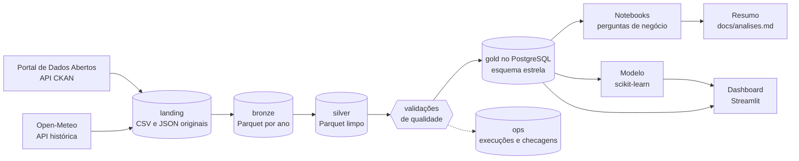
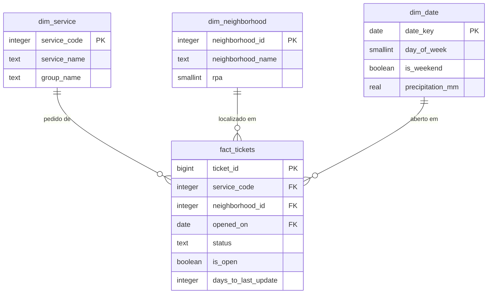
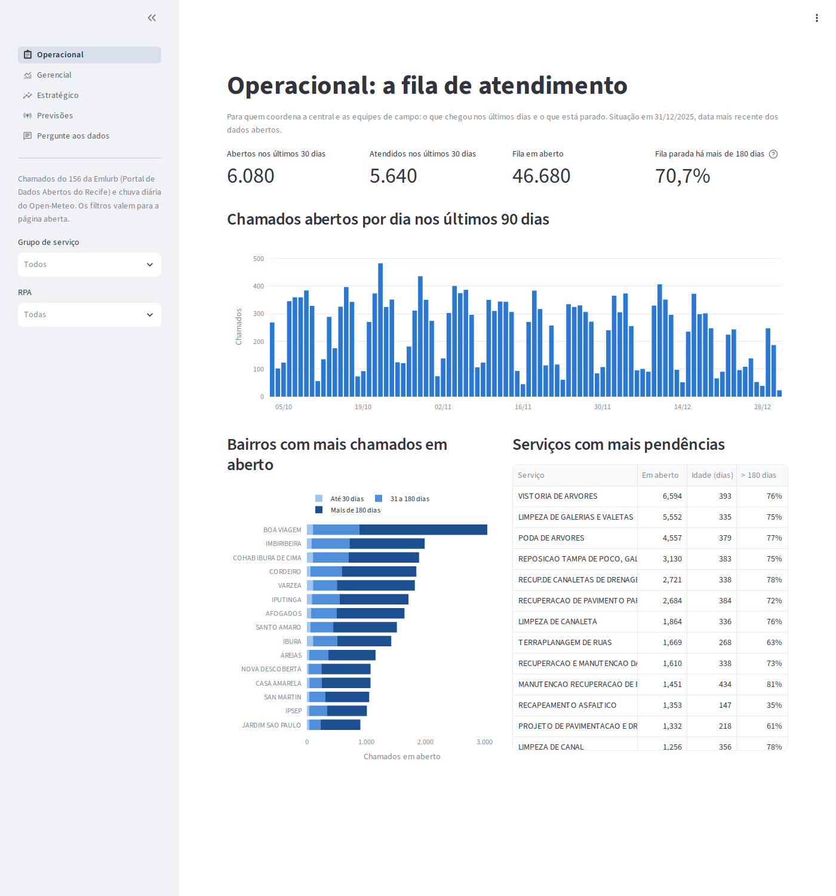
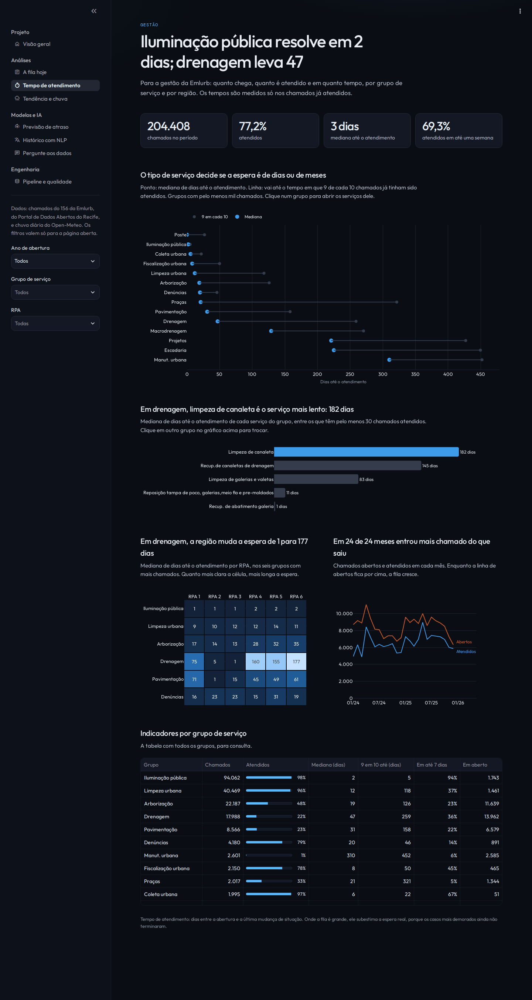
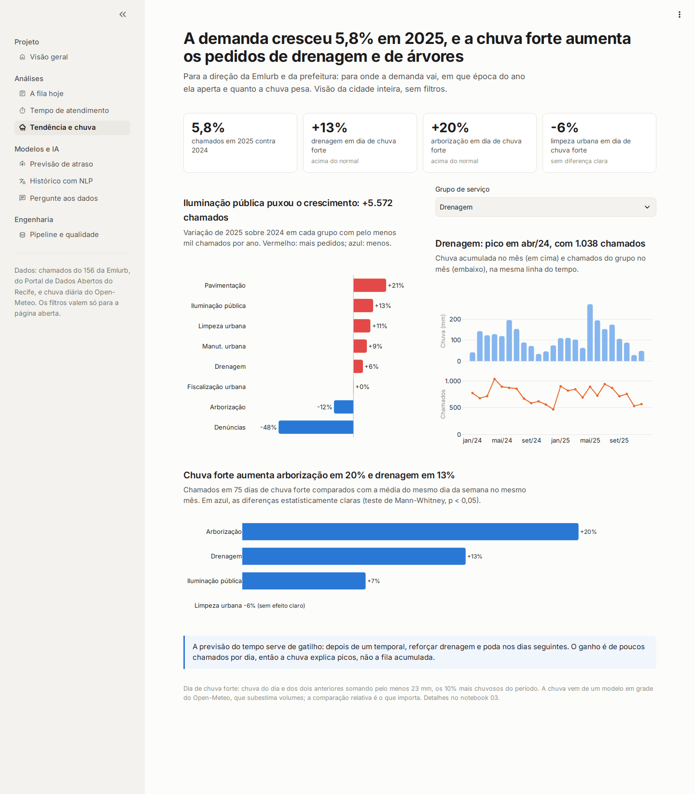
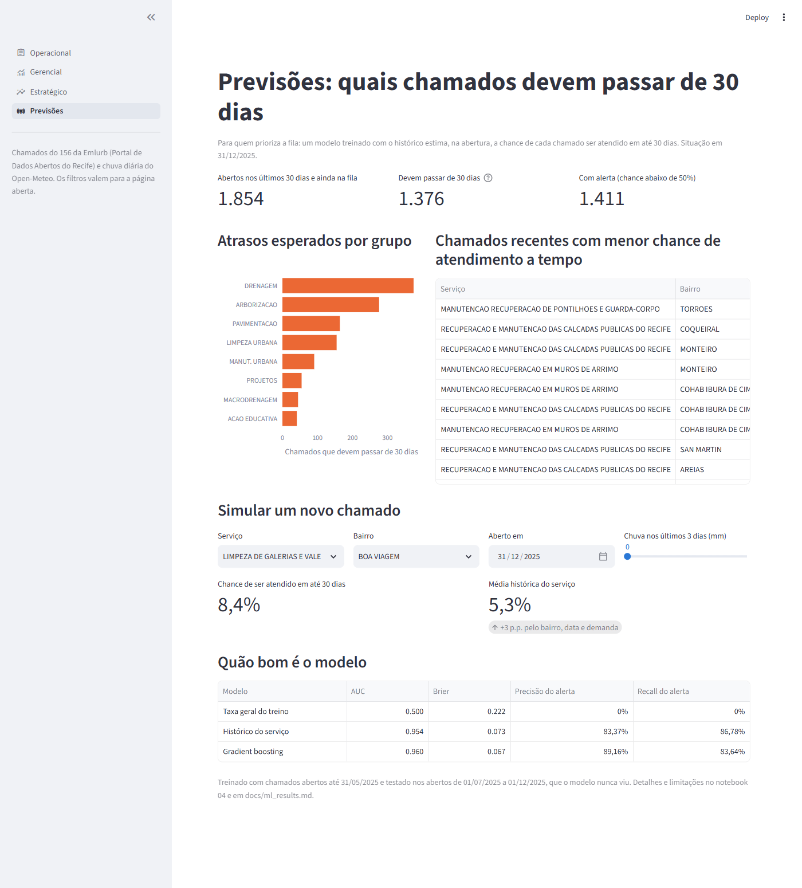
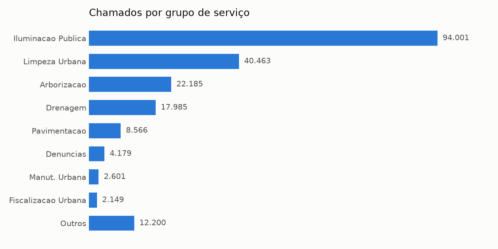
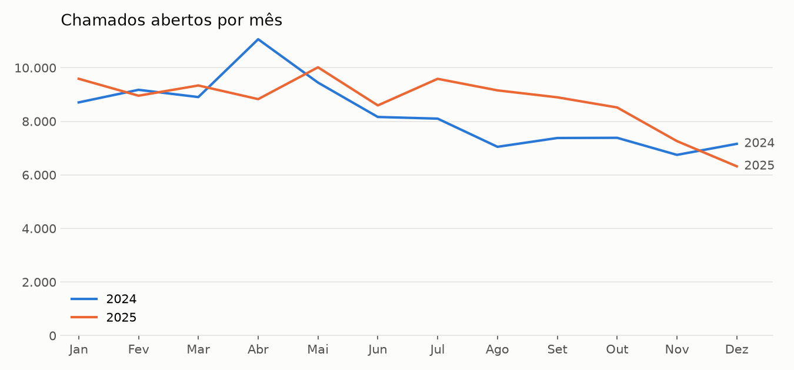
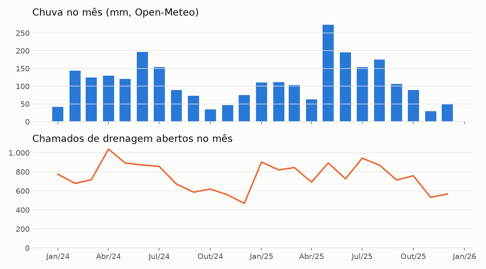

# Recife 156: o que os chamados de serviços urbanos revelam sobre a cidade

[](https://github.com/nogsposito/recife-156/actions/workflows/ci.yml)

Pipeline de dados ponta a ponta sobre os chamados do 156 da Emlurb, a central em que moradores do Recife pedem conserto de iluminação, limpeza, poda de árvores, drenagem, pavimentação e outros serviços urbanos. O projeto cruza os dados abertos da prefeitura com a chuva diária da cidade, organiza o tratamento em camadas (bronze, silver e gold) com ingestão incremental e validações de qualidade, modela a camada final em esquema estrela no PostgreSQL, responde perguntas de gestão com SQL em notebooks que registram cada descoberta, treina um modelo que prevê na abertura se um chamado será atendido em até 30 dias e entrega um dashboard com uma visão para cada público: quem opera a central, quem gere os serviços e quem decide a estratégia.

## O problema

A prefeitura recebe mais de 100 mil chamados por ano no 156. Para quem gere esses serviços, as perguntas práticas são: onde está a demanda, quanto tempo cada tipo de pedido leva para ser atendido, se alguma região da cidade espera mais que as outras, quanto da fila está parada há meses e se a chuva, frequente no Recife, antecipa picos de demanda. Os dados públicos permitem responder isso, mas chegam em CSVs anuais com formatos inconsistentes, sem identificador de chamado e com o mesmo pedido repetido em arquivos de anos diferentes.

## Os dados

| Fonte | Formato | Acesso |
|---|---|---|
| [Central de Atendimento de Serviços da Emlurb (156)](https://dados.recife.pe.gov.br/dataset/central-de-atendimento-de-servicos-da-emlurb-156), Portal de Dados Abertos do Recife | CSV por ano, licença ODbL | API CKAN para descobrir os arquivos, download direto |
| [Open-Meteo, API histórica](https://open-meteo.com/en/docs/historical-weather-api) | JSON com chuva e temperatura diárias, licença CC BY 4.0 | API REST sem chave |

O recorte padrão cobre os chamados abertos em 2024 e 2025: 204.408 chamados depois da limpeza. Os problemas encontrados nos arquivos (anos que se sobrepõem, mesmo chamado em mais de um arquivo, grafias diferentes, coordenadas inválidas) e a decisão tomada em cada caso estão no notebook [01_data_cleaning.ipynb](notebooks/01_data_cleaning.ipynb); o schema real e as regras de limpeza, em [docs/data_dictionary.md](docs/data_dictionary.md). A chuva vem de um modelo em grade, e não de um pluviômetro: serve para comparar dias entre si, não para medir milímetros (ver o [notebook 03](notebooks/03_weather_hypothesis.ipynb)).

## Arquitetura



1. Ingestão incremental ([src/ingestion](src/ingestion)): consulta a API CKAN e o Open-Meteo, guarda os arquivos originais em `data/raw` e grava cada ano na bronze em Parquet, com colunas de origem. Um manifesto registra a versão e o hash de cada arquivo, e só o que mudou desde a última execução é baixado e regravado.
2. Silver ([src/layers/silver.py](src/layers/silver.py), [src/transform/cleaning.py](src/transform/cleaning.py)): tipa datas e números, padroniza textos, anula placeholders e coordenadas fora do Recife e mantém só a versão mais recente de cada chamado que aparece em mais de um arquivo anual. As regras nasceram das descobertas do [notebook 01](notebooks/01_data_cleaning.ipynb), que usa as mesmas funções.
3. Qualidade ([src/quality/checks.py](src/quality/checks.py)): doze validações sobre a silver. Uma falha grave interrompe a execução antes de tocar na gold.
4. Gold ([sql/schema.sql](sql/schema.sql), [src/transform/modeling.py](src/transform/modeling.py), [src/db/load.py](src/db/load.py)): fato de chamados e dimensões de serviço, bairro e data (com o clima do dia), carregados com `COPY` e indexados em uma única transação.
5. Análise ([notebooks](notebooks), [sql/analyses](sql/analyses)): cinco perguntas de gestão e o efeito da chuva, respondidos com dez consultas SQL versionadas e três hipóteses testadas. As conclusões ficam em [docs/analises.md](docs/analises.md).
6. Modelo ([src/ml](src/ml)): prevê, na abertura, a chance de um chamado ser atendido em até 30 dias, com validação temporal contra dois baselines. `make train` treina e salva o modelo.
7. Dashboard ([app/](app)): quatro páginas em Streamlit e Plotly, uma por público mais a de previsões, lendo a gold pela view `v_tickets`.

O detalhe de cada camada, o fluxo de uma execução e o modelo completo estão em [docs/architecture.md](docs/architecture.md). As decisões de arquitetura têm registro próprio: [PostgreSQL](docs/adr/0001-postgresql-como-banco-analitico.md), [camadas](docs/adr/0002-camadas-bronze-silver-gold.md), [Parquet](docs/adr/0003-parquet-para-bronze-e-silver.md) e [carga incremental até a bronze e completa na gold](docs/adr/0004-carga-completa-da-gold.md).

### Modelo da camada gold



`is_open` e `days_to_last_update` são colunas geradas pelo próprio PostgreSQL; para chamados atendidos, `days_to_last_update` é o tempo de resolução.

## Qualidade e confiabilidade

- Idempotência: rodar o pipeline duas vezes seguidas dá a mesma gold. A segunda execução reconhece pelo manifesto que nada mudou no portal nem no clima e não baixa nada.
- Incremental: um ano só é baixado de novo quando o portal publica outra versão, e só é regravado na bronze quando o conteúdo também mudou (comparação por hash). Se o portal estiver fora do ar e a bronze já existir, o pipeline segue com ela e registra um aviso.
- Validações: campos obrigatórios, datas dentro do recorte e coerentes entre si, RPA válida, coordenadas dentro do Recife, um grupo por serviço, um registro de clima por dia e clima para todos os dias com chamado. Situações nunca vistas e bairros faltando acima de 1% geram só alerta.
- Rastreabilidade: cada execução fica em `ops.pipeline_runs` (o que mudou, quantas linhas, sucesso ou falha) e cada validação em `ops.quality_checks`.
- Atomicidade: a gold é recriada em uma única transação; uma falha no meio deixa a versão anterior intacta.

## SQL e otimização

As consultas em [sql/analyses](sql/analyses) usam CTEs, window functions (participação acumulada, comparação com o mesmo mês do ano anterior via `LAG`, rankings com `RANK ... PARTITION BY`, soma acumulada da fila e média móvel de três meses), percentis e agregações filtradas. As consultas de [sql/benchmark](sql/benchmark) calculam médias móveis de 7 e 28 dias sobre a dimensão de data.

`make benchmark` mede três consultas pesadas com `EXPLAIN ANALYZE`, sem e com os índices de [sql/indexes.sql](sql/indexes.sql), e grava os tempos em [docs/sql_optimization.md](docs/sql_optimization.md):

| Consulta | Sem índice | Com índice |
|---|---|---|
| Fila em aberto de um bairro, mais antigos primeiro | 35,8 ms | 0,3 ms |
| Médias móveis de 7 e 28 dias de um serviço | 33,0 ms | 3,0 ms |
| Chamados por dia e grupo com a chuva do dia | 345,5 ms | 315,4 ms |

O índice parcial só dos chamados em aberto é o que mais ganha (perto de cem vezes). Na terceira consulta, que precisa contar a tabela inteira, índice não ajuda; o que funcionou foi reescrevê-la para agregar antes de juntar com o calendário, o que a deixou cerca de 2,5 vezes mais rápida com o mesmo resultado.

## Modelo de previsão

Objetivo: saber, no momento em que o chamado é aberto, se ele deve ser atendido em até 30 dias. Isso dá à central um prazo realista para informar ao cidadão e à supervisão uma lista dos chamados que provavelmente vão atrasar.

Por que classificação e não "quantos dias": 23% dos chamados ainda estão abertos e não têm tempo de resolução. Prever "atendido em até 30 dias, sim ou não" usa esses chamados sem viés (aberto há mais de 30 dias é um "não" conhecido); só ficam de fora os abertos nos últimos 30 dias.

Validação temporal: treino com chamados abertos até 31/05/2025, intervalo de 30 dias e teste com os abertos de 01/07 a 01/12/2025, que o modelo nunca viu. Nada de divisão aleatória.

| Modelo | AUC | Brier | Precisão do alerta | Recall do alerta |
|---|---|---|---|---|
| Taxa geral do treino | 0,500 | 0,222 | - | - |
| Histórico do serviço | 0,954 | 0,073 | 83,4% | 86,8% |
| Gradient boosting (scikit-learn) | 0,960 | 0,067 | 89,2% | 83,6% |

Como interpretar: o tipo de serviço praticamente decide o prazo, então a taxa histórica de cada serviço já é uma régua muito forte. O modelo fica acima dela em todas as métricas de probabilidade, e o alerta "não deve ser atendido em 30 dias" (chance abaixo de 50%) acerta 89% das vezes contra 83% do histórico. O ganho vem quase todo do bairro e aparece onde o prazo é incerto: o erro cai 38% em arborização e 25% em drenagem, e em iluminação e limpeza o modelo empata com o histórico. Chuva, mês e dia da semana mudam o volume de chamados, mas não o prazo de cada um. O raciocínio completo, a calibração e as limitações estão no notebook [04_resolution_model.ipynb](notebooks/04_resolution_model.ipynb), e os números de cada treino em [docs/ml_results.md](docs/ml_results.md).

## Como rodar

Pré-requisito: Docker com Docker Compose. O `make` é opcional e só encurta os comandos.

```bash
git clone https://github.com/nogsposito/recife-156.git
cd recife-156
docker compose up --build
```

O Compose sobe o PostgreSQL, roda o pipeline uma vez (ingestão, silver, validações e gold), treina o modelo e, quando tudo termina, abre o dashboard em `http://localhost:8501`. A primeira execução leva alguns minutos (build da imagem e download de cerca de 40 MB); as seguintes, cerca de um minuto, sem novos downloads. O banco fica em `localhost:5433` (usuário, senha e banco em [.env.example](.env.example)).

Os notebooks já estão no repositório com os resultados. Para explorá-los, `make jupyter` abre o JupyterLab em `http://localhost:8888`; para reexecutá-los com o banco carregado, `make notebooks`.

Com `make`:

| Comando | O que faz |
|---|---|
| `make pipeline` | Roda tudo: ingestão do que mudou, silver, validações e gold |
| `make refresh` | Igual a `pipeline`, mas baixa e reconstrói todas as camadas do zero |
| `make ingest` | Só traz para a bronze os arquivos novos ou alterados |
| `make load` | Monta a silver a partir da bronze, valida e carrega a gold |
| `make train` | Treina o modelo de 30 dias e atualiza `docs/ml_results.md` |
| `make benchmark` | Mede as consultas pesadas com e sem índices |
| `make dashboard` | Abre o dashboard com os dados já carregados, sem rodar o pipeline |
| `make notebooks` | Reexecuta os notebooks, atualizando resultados e gráficos |
| `make jupyter` | Abre o JupyterLab com os notebooks |
| `make test` / `make lint` | Testes (pytest) / estilo e formatação (ruff) |
| `make psql` | Abre um terminal SQL no banco |
| `make down` / `make clean` | Para os containers / apaga também o banco e todas as camadas de arquivos |

Para mudar o recorte, copie `.env.example` para `.env` e ajuste `YEARS` (por exemplo `YEARS=2024,2025,2026`). Anos anteriores a 2024 usam outra codificação de serviços e são recusados com uma mensagem explicando o motivo.

Todos os comandos rodam dentro de containers, então não é preciso instalar Python. Para rodar fora do Docker, com Python 3.11 ou mais recente: `pip install -e ".[dev,notebooks]"`, suba só o banco com `docker compose up -d db` e use `python -m src.pipeline`.

## Testes e integração contínua

Os testes em [tests](tests) cobrem as regras de limpeza, a deduplicação entre arquivos anuais, a escolha do arquivo no portal, a ingestão incremental (pular o que não mudou, não regravar conteúdo igual), as validações de qualidade, a montagem do esquema estrela, a leitura do clima e as features do modelo (alvo, demanda sem olhar o futuro, divisão temporal). Nenhum deles precisa de banco ou internet.

O workflow [.github/workflows/ci.yml](.github/workflows/ci.yml) roda lint, checagem de formatação e testes em todo pull request e em todo push para `main`.

## Dashboard

Cada página responde às perguntas de um público diferente e tem filtros por grupo de serviço e região quando eles fazem sentido.

Operacional, para quem coordena a central e as equipes: o que chegou nos últimos dias, o tamanho e a idade da fila, os bairros e serviços com mais pendências.



Gerencial, para a gestão da Emlurb: volume, taxa de atendimento e tempos por grupo de serviço, evolução mensal de abertos e atendidos e tempo por região.



Estratégico, para a direção: variação entre anos por grupo, sazonalidade ao lado da chuva e quanto a chuva forte muda cada serviço.



Previsões, para quem prioriza a fila: atrasos esperados por grupo, os chamados recentes com menor chance de atendimento a tempo, um simulador para um novo chamado e a avaliação do modelo.



## Principais achados

Números do recorte padrão (2024 e 2025). O passo a passo está nos notebooks [02](notebooks/02_business_analysis.ipynb) e [03](notebooks/03_weather_hypothesis.ipynb) e o resumo, em [docs/analises.md](docs/analises.md).



A demanda é muito concentrada. Iluminação pública responde por 46% dos chamados, e os 10 serviços mais pedidos, de 108, somam 78% do total. Só "lâmpada apagada" representa 35,6% de tudo o que chega ao 156, o que faz dele o primeiro candidato a manutenção preventiva ou a um canal de pedido automatizado (hipótese H1, confirmada).

A velocidade de atendimento depende muito do tipo de serviço. Iluminação tem mediana de 2 dias, com 94% dos chamados atendidos resolvidos em até uma semana. Drenagem tem mediana de 47 dias entre os atendidos, e 13.962 dos 17.988 chamados de drenagem abertos no período (78%) ainda estavam em aberto no fim de 2025, três quartos deles há mais de 180 dias. E a fila cresce: entre os chamados abertos desde janeiro de 2024, entrou mais do que saiu em todos os 24 meses, cerca de 1.900 por mês.


A região da cidade também pesa, mas só em alguns serviços (hipótese H2, refutada em parte). Em iluminação e limpeza urbana, o tempo é parecido em todas as RPAs. Em drenagem, as RPAs 4, 5 e 6 (oeste, sudoeste e sul) têm medianas entre 155 e 177 dias, contra 1 a 5 dias nas RPAs 2 e 3 (norte e noroeste). A diferença continua quando se olha um único serviço: limpeza de galerias leva de 35 a 69 dias nas RPAs 1 a 3 e de 155 a 197 nas RPAs 4 a 6. Isso aponta para capacidade ou contratos regionais, não para o tipo de pedido.



O volume cresceu em 2025, puxado pelo segundo semestre (julho a outubro ficaram de 15% a 30% acima do mesmo mês de 2024). Dias úteis concentram cerca de 90% dos chamados.



A chuva forte aumenta os chamados, mas não explica a fila (hipótese H3, confirmada com efeito moderado). Comparando cada dia com o normal daquele mês e dia da semana, os 75 dias de chuva forte tiveram 13% mais chamados de drenagem e 20% mais de arborização (Mann-Whitney, p < 0,01), enquanto limpeza urbana não subiu. A previsão do tempo é um bom gatilho para reforçar drenagem e poda depois de temporais, mas são poucos chamados a mais por dia: a fila de drenagem vem da velocidade de atendimento, não dos temporais.

## Estrutura do repositório

```
src/
  config.py              variáveis de ambiente e caminhos das camadas
  pipeline.py            orquestra ingestão, silver, validações e gold
  ingestion/             API CKAN e Open-Meteo, com ingestão incremental para a bronze
  layers/                escrita e leitura de bronze (com manifesto) e silver
  transform/             regras de limpeza e montagem do esquema estrela
  quality/checks.py      validações de qualidade da silver
  db/load.py             carga da gold e registro das execuções
  benchmark.py           EXPLAIN ANALYZE com e sem índices
  ml/                    features, treino com validação temporal e previsão
  analysis/              padrão visual dos gráficos e cálculo do efeito da chuva
  dashboard/             leitura dos dados e estilo do dashboard
app/                     dashboard Streamlit (navegação e quatro páginas)
notebooks/               limpeza, análise de negócio, efeito da chuva e modelo
sql/
  schema.sql             esquema estrela e view do dashboard
  indexes.sql            índices da tabela fato
  ops.sql                histórico de execuções e validações
  analyses/              dez consultas analíticas
  benchmark/             consultas usadas no benchmark de otimização
tests/                   testes de limpeza, ingestão, qualidade, modelagem e features do modelo
docs/                    arquitetura, ADRs, otimização, dicionário de dados, resumo e gráficos
.github/workflows/       integração contínua
```

## Decisões e limitações

- Sem identificador de chamado nos dados abertos, o mesmo chamado em anos diferentes é reconhecido por serviço, endereço, bairro e data de abertura. A regra é uma aproximação: dois pedidos iguais no mesmo dia e endereço viram dois chamados.
- A situação de cada chamado é a do fim do último ano carregado. Tempo de resolução só existe para chamados atendidos, então as medianas subestimam a espera em serviços com fila grande, como drenagem.
- A data de atendimento é a data da última mudança de situação, que depende de como cada equipe registra o andamento.
- A ingestão é incremental, mas silver e gold são recalculadas por completo a cada execução: sem identificador estável de chamado, uma carga incremental da gold poderia mudar a identidade dos chamados entre execuções. Para cerca de 200 mil linhas isso leva menos de um minuto.
- Pouco mais da metade das linhas não tem coordenadas, então as análises usam bairro e RPA em vez de pontos no mapa.
- A chuva vem de um único ponto do modelo em grade do Open-Meteo, que subestima volumes e suaviza temporais. Ela serve para separar dias mais e menos chuvosos; dados de pluviômetro por bairro dariam um teste mais forte.
- O dashboard mostra a situação na data mais recente dos dados abertos (31/12/2025), não em tempo real.
- O modelo não conhece capacidade das equipes, contratos ou mutirões, que provavelmente explicam boa parte da diferença entre regiões, e o tempo de atendimento depende de como cada equipe registra o andamento. Ele é retreinado a cada carga para acompanhar mudanças.

## Tecnologias

Python 3.12, pandas, pyarrow (Parquet), requests, SQLAlchemy e psycopg 3, PostgreSQL 16, Streamlit, Plotly, scikit-learn, SciPy, Jupyter, matplotlib, pytest, ruff, GitHub Actions, Docker Compose e Make.

## Licença

Código sob licença MIT. Os dados são da Prefeitura do Recife, publicados sob a Open Database License (ODbL).
