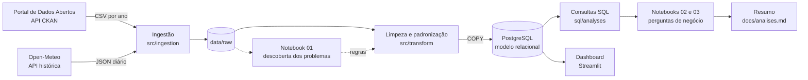
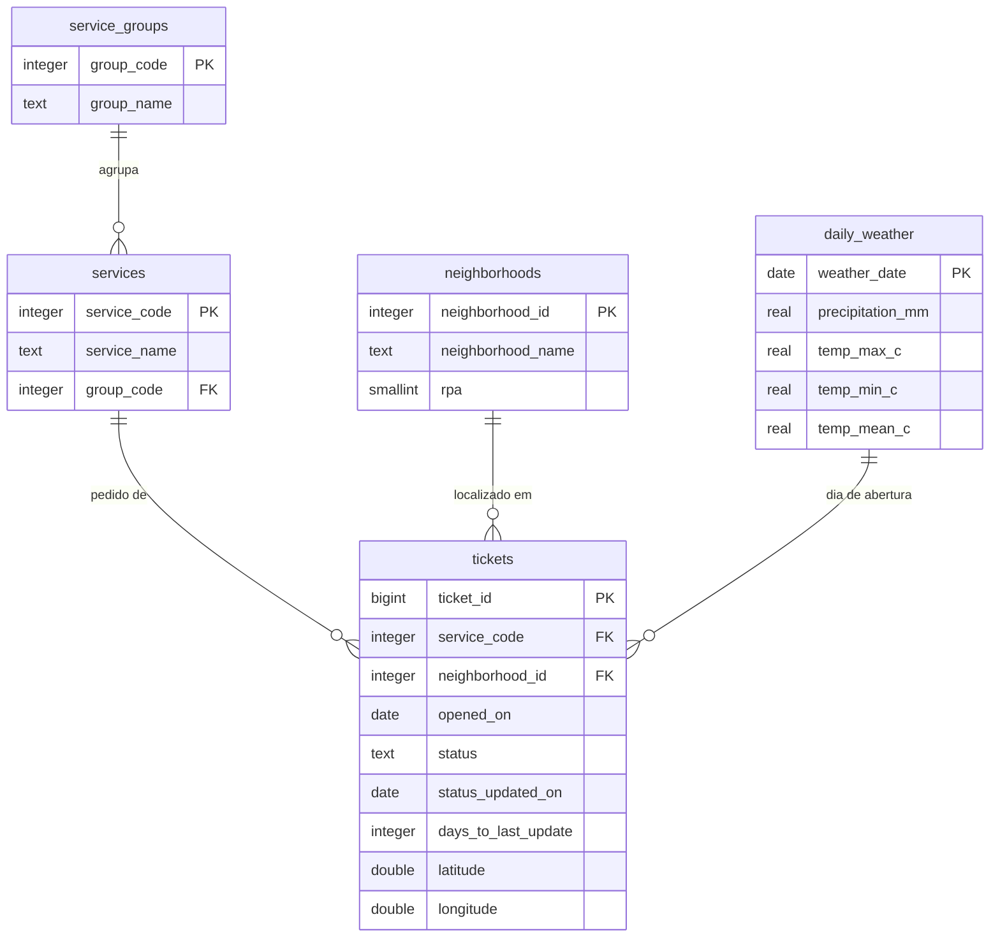

# Recife 156: o que os chamados de serviços urbanos revelam sobre a cidade

Pipeline de dados ponta a ponta sobre os chamados do 156 da Emlurb, a central em que moradores do Recife pedem conserto de iluminação, limpeza, poda de árvores, drenagem, pavimentação e outros serviços urbanos. O projeto cruza os dados abertos da prefeitura com a chuva diária da cidade, trata e padroniza os arquivos, carrega tudo em um banco PostgreSQL modelado, responde perguntas de gestão com SQL em notebooks que registram cada descoberta e entrega um dashboard com uma visão para cada público: quem opera a central, quem gere os serviços e quem decide a estratégia.

## O problema

A prefeitura recebe mais de 100 mil chamados por ano no 156. Para quem gere esses serviços, as perguntas práticas são: onde está a demanda, quanto tempo cada tipo de pedido leva para ser atendido, se alguma região da cidade espera mais que as outras, quanto da fila está parada há meses e se a chuva, frequente no Recife, antecipa picos de demanda. Os dados públicos permitem responder isso, mas chegam em CSVs anuais com formatos inconsistentes, sem identificador de chamado e com o mesmo pedido repetido em arquivos de anos diferentes.

## Os dados

| Fonte | Formato | Acesso |
|---|---|---|
| [Central de Atendimento de Serviços da Emlurb (156)](https://dados.recife.pe.gov.br/dataset/central-de-atendimento-de-servicos-da-emlurb-156), Portal de Dados Abertos do Recife | CSV por ano, licença ODbL | API CKAN para descobrir os arquivos, download direto |
| [Open-Meteo, API histórica](https://open-meteo.com/en/docs/historical-weather-api) | JSON com chuva e temperatura diárias, licença CC BY 4.0 | API REST sem chave |

O recorte padrão cobre os chamados abertos em 2024 e 2025: 204.408 chamados depois da limpeza. Os problemas encontrados nos arquivos (anos que se sobrepõem, mesmo chamado em mais de um arquivo, grafias diferentes, coordenadas inválidas) e a decisão tomada em cada caso estão no notebook [01_data_cleaning.ipynb](notebooks/01_data_cleaning.ipynb); o schema real e as regras de limpeza, em [docs/data_dictionary.md](docs/data_dictionary.md). A chuva vem de um modelo em grade, e não de um pluviômetro: serve para comparar dias entre si, não para medir milímetros (ver o [notebook 03](notebooks/03_weather_hypothesis.ipynb)).

## Arquitetura



1. Ingestão ([src/ingestion/ckan.py](src/ingestion/ckan.py), [src/ingestion/weather.py](src/ingestion/weather.py)): consulta a API CKAN, escolhe o arquivo mais recente de cada ano pedido e baixa para `data/raw`. O clima diário vem da API histórica do Open-Meteo para exatamente os dias cobertos pelos chamados, e o JSON bruto fica guardado ao lado dos CSVs. Arquivos já baixados são reaproveitados.
2. Limpeza ([src/transform/cleaning.py](src/transform/cleaning.py)): tipa datas e números, padroniza textos (caixa, acentos, espaços), anula placeholders e coordenadas fora do Recife e mantém só a versão mais recente de cada chamado que aparece em mais de um arquivo anual. As regras nasceram das descobertas do [notebook 01](notebooks/01_data_cleaning.ipynb), que usa as mesmas funções do pipeline.
3. Modelagem e carga ([src/transform/modeling.py](src/transform/modeling.py), [src/db/load.py](src/db/load.py)): separa grupos, serviços e bairros em tabelas próprias, liga cada chamado ao clima do dia em que foi aberto e carrega tudo com `COPY` em uma única transação. A view `v_tickets` junta chamado, serviço, grupo e bairro para o dashboard.
4. Análise ([notebook 02](notebooks/02_business_analysis.ipynb), [notebook 03](notebooks/03_weather_hypothesis.ipynb), [sql/analyses](sql/analyses)): cinco perguntas de gestão e o efeito da chuva, respondidos com nove consultas SQL versionadas e três hipóteses de negócio testadas. As conclusões ficam resumidas em [docs/analises.md](docs/analises.md).
5. Dashboard ([app/](app)): três páginas em Streamlit e Plotly, uma por público, lendo direto do PostgreSQL.

### Modelo de dados



A coluna `days_to_last_update` é calculada pelo próprio PostgreSQL (coluna gerada) e, para chamados atendidos, é o tempo de resolução.

## Como rodar

Pré-requisito: Docker com Docker Compose. O `make` é opcional e só encurta os comandos.

```bash
git clone https://github.com/nogsposito/recife-156.git
cd recife-156
docker compose up --build
```

O Compose sobe o PostgreSQL, roda o pipeline uma vez (baixa os CSVs e o clima, limpa e carrega o banco) e, quando a carga termina, abre o dashboard em `http://localhost:8501`. A primeira execução leva alguns minutos (build da imagem e download de cerca de 40 MB); as seguintes, cerca de um minuto. O banco fica em `localhost:5433` (usuário, senha e banco em [.env.example](.env.example)).

Os notebooks já estão no repositório com os resultados. Para explorá-los, `make jupyter` abre o JupyterLab em `http://localhost:8888`; para reexecutá-los com o banco carregado, `make notebooks`.

Com `make`:

| Comando | O que faz |
|---|---|
| `make pipeline` | Baixa, limpa e carrega os dados no PostgreSQL |
| `make ingest` | Só baixa os arquivos do portal |
| `make load` | Limpa os arquivos baixados e carrega o PostgreSQL |
| `make dashboard` | Abre o dashboard com os dados já carregados, sem rodar o pipeline |
| `make notebooks` | Reexecuta os dois notebooks, atualizando resultados e gráficos |
| `make jupyter` | Abre o JupyterLab com os notebooks |
| `make test` | Roda os testes (pytest) |
| `make lint` | Verifica estilo e formatação (ruff) |
| `make psql` | Abre um terminal SQL no banco |
| `make down` / `make clean` | Para os containers / apaga também o banco e os arquivos baixados |

Para mudar o recorte, copie `.env.example` para `.env` e ajuste `YEARS` (por exemplo `YEARS=2024,2025,2026`). Anos anteriores a 2024 usam outra codificação de serviços e são recusados com uma mensagem explicando o motivo.

Todos os comandos rodam dentro de containers, então não é preciso instalar Python. Para rodar fora do Docker, com Python 3.11 ou mais recente: `pip install -e ".[dev,notebooks]"`, suba só o banco com `docker compose up -d db` e use `python -m src.pipeline`.

## Dashboard

Cada página responde às perguntas de um público diferente e tem filtros por grupo de serviço e região quando eles fazem sentido.

Operacional, para quem coordena a central e as equipes: o que chegou nos últimos dias, o tamanho e a idade da fila, os bairros e serviços com mais pendências.


Gerencial, para a gestão da Emlurb: volume, taxa de atendimento e tempos por grupo de serviço, evolução mensal de abertos e atendidos e tempo por região.


Estratégico, para a direção: variação entre anos por grupo, sazonalidade ao lado da chuva e quanto a chuva forte muda cada serviço.


## Principais achados

Números do recorte padrão (2024 e 2025). O passo a passo está no [notebook 02](notebooks/02_business_analysis.ipynb) e o resumo, em [docs/analises.md](docs/analises.md).


A demanda é muito concentrada. Iluminação pública responde por 46% dos chamados, e os 10 serviços mais pedidos, de 108, somam 78% do total. Só "lâmpada apagada" representa 35,6% de tudo o que chega ao 156, o que faz dele o primeiro candidato a manutenção preventiva ou a um canal de pedido automatizado (hipótese H1, confirmada).

A velocidade de atendimento depende muito do tipo de serviço. Iluminação tem mediana de 2 dias, com 94% dos chamados atendidos resolvidos em até uma semana. Drenagem tem mediana de 47 dias entre os atendidos, e 13.962 dos 17.988 chamados de drenagem abertos no período (78%) ainda estavam em aberto no fim de 2025, três quartos deles há mais de 180 dias.


A região da cidade também pesa, mas só em alguns serviços (hipótese H2, refutada em parte). Em iluminação e limpeza urbana, o tempo é parecido em todas as RPAs. Em drenagem, as RPAs 4, 5 e 6 (oeste, sudoeste e sul) têm medianas entre 155 e 177 dias, contra 1 a 5 dias nas RPAs 2 e 3 (norte e noroeste). A diferença continua quando se olha um único serviço: limpeza de galerias leva de 35 a 69 dias nas RPAs 1 a 3 e de 155 a 197 nas RPAs 4 a 6. Isso aponta para capacidade ou contratos regionais, não para o tipo de pedido.


O volume cresceu em 2025, puxado pelo segundo semestre (julho a outubro ficaram de 15% a 30% acima do mesmo mês de 2024). Dias úteis concentram cerca de 90% dos chamados.


A chuva forte aumenta os chamados, mas não explica a fila (hipótese H3, confirmada com efeito moderado). Comparando cada dia com o normal daquele mês e dia da semana, os 75 dias de chuva forte tiveram 13% mais chamados de drenagem e 20% mais de arborização (Mann-Whitney, p < 0,01), enquanto limpeza urbana não subiu. A previsão do tempo é um bom gatilho para reforçar drenagem e poda depois de temporais, mas são poucos chamados a mais por dia: a fila de drenagem vem da velocidade de atendimento, não dos temporais.

## Estrutura do repositório

```
src/
  config.py            variáveis de ambiente e caminhos
  pipeline.py          orquestra as etapas (python -m src.pipeline --step ...)
  ingestion/ckan.py    descoberta e download dos arquivos pela API CKAN
  ingestion/weather.py chuva e temperatura diárias pela API do Open-Meteo
  transform/           limpeza, deduplicação e montagem das tabelas
  db/load.py           criação do schema e carga com COPY
  analysis/            padrão visual dos gráficos e cálculo do efeito da chuva
  dashboard/           leitura dos dados e estilo do dashboard
app/
  main.py              navegação do dashboard
  views/               páginas operacional, gerencial e estratégica
notebooks/
  01_data_cleaning.ipynb       problemas encontrados nos dados e como foram tratados
  02_business_analysis.ipynb   perguntas de negócio, hipóteses e gráficos
  03_weather_hypothesis.ipynb  efeito da chuva nos chamados
sql/
  schema.sql           modelo relacional e view do dashboard
  analyses/            nove consultas analíticas (CTEs, window functions, percentis)
tests/                 testes das funções de limpeza e ingestão
docs/                  resumo das análises, dicionário de dados e gráficos
```

## Decisões e limitações

- Sem identificador de chamado nos dados abertos, o mesmo chamado em anos diferentes é reconhecido por serviço, endereço, bairro e data de abertura. A regra é uma aproximação: dois pedidos iguais no mesmo dia e endereço viram dois chamados.
- A situação de cada chamado é a do fim do último ano carregado. Tempo de resolução só existe para chamados atendidos, então as medianas subestimam a espera em serviços com fila grande, como drenagem.
- A data de atendimento é a data da última mudança de situação, que depende de como cada equipe registra o andamento.
- A carga é uma atualização completa (o schema é recriado a cada execução), simples e suficiente para cerca de 200 mil linhas.
- Pouco mais da metade das linhas não tem coordenadas, então as análises usam bairro e RPA em vez de pontos no mapa.
- A chuva vem de um único ponto do modelo em grade do Open-Meteo, que subestima volumes e suaviza temporais. Ela serve para separar dias mais e menos chuvosos; dados de pluviômetro por bairro dariam um teste mais forte.
- O dashboard mostra a situação na data mais recente dos dados abertos (31/12/2025), não em tempo real.

## Tecnologias

Python 3.12, pandas, requests, SQLAlchemy e psycopg 3, PostgreSQL 16, Streamlit, Plotly, SciPy, Jupyter, matplotlib, pytest, ruff, Docker Compose e Make.

## Licença

Código sob licença MIT. Os dados são da Prefeitura do Recife, publicados sob a Open Database License (ODbL).
