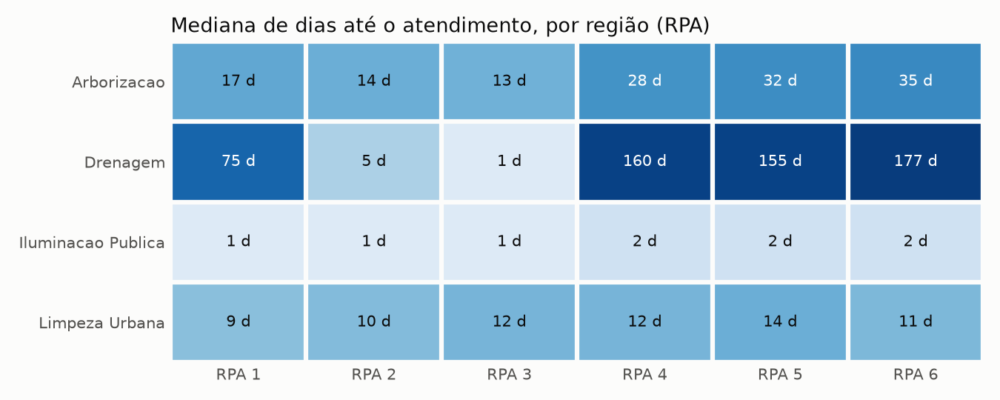

# O que descobrimos nos chamados do 156

Resumo dos notebooks [01_data_cleaning](../notebooks/01_data_cleaning.ipynb) (como os dados foram entendidos e tratados) [02_business_analysis](../notebooks/02_business_analysis.ipynb) (as perguntas de negócio, com as consultas e os gráficos) e [03_weather_hypothesis](../notebooks/03_weather_hypothesis.ipynb) (o efeito da chuva). Recorte: 204.408 chamados abertos em 2024 e 2025, com a situação conhecida até 31/12/2025.

Em uma frase: o 156 recebe sobretudo pedidos de iluminação, que são atendidos em poucos dias; o problema está em drenagem e arborização, onde a espera depende da região da cidade, a fila em aberto é grande e antiga e a chuva forte empurra a demanda para cima.

## Principais descobertas

1. Poucos serviços concentram a demanda. 10 de 108 serviços somam 78% dos chamados, e "lâmpada apagada" sozinho é 35,6%. Prevenção na iluminação, ou autoatendimento para esse pedido, é a alavanca de maior efeito sobre o volume da central.

2. O tipo de serviço define a espera. Iluminação tem mediana de 2 dias e 94% dos chamados atendidos em até uma semana. Drenagem tem mediana de 47 dias, pavimentação 31 e arborização 19.

3. Em drenagem e arborização, a região também pesa. No mesmo serviço (limpeza de galerias e valetas), as RPAs 4, 5 e 6 esperam de 155 a 197 dias, contra 35 a 69 nas RPAs 1 a 3. Isso aponta para capacidade ou contrato regional, e não para o tipo de pedido. Em iluminação e limpeza urbana o tempo é parecido em toda a cidade.

4. A fila parada está em drenagem e arborização. 78% dos pedidos de drenagem do período seguiam em aberto no fim de 2025 (13.962 chamados), três quartos deles há mais de 180 dias; arborização tem 11.639 em aberto. E a fila cresce: entre os chamados abertos desde janeiro de 2024, entrou mais do que saiu em todos os 24 meses, cerca de 1.900 por mês. Parte disso pode ser chamado resolvido sem baixa no sistema, e uma revisão da fila antiga separaria pendência real de falha de registro.

5. A demanda cresceu 5,8% em 2025, concentrada de julho a outubro (15% a 30% acima de 2024). Dias úteis recebem cerca de 3,5 vezes mais chamados por dia que sábados e domingos.

6. Chuva forte aumenta a demanda, mas não explica a fila. Nos 75 dias mais chuvosos, drenagem ficou 13% acima do normal para aquele mês e dia da semana e arborização, 20%; limpeza urbana não subiu. A previsão do tempo serve de gatilho para reforçar drenagem e poda depois de temporais, mas o ganho é de poucos chamados por dia (cerca de 3 em drenagem e 6 em arborização).

## Hipóteses testadas

| Hipótese | Critério | Resultado |
|---|---|---|
| H1. Os 10 serviços mais pedidos somam pelo menos 70% dos chamados | Participação acumulada dos serviços | Confirmada: 78% |
| H2. Dentro de um mesmo grupo de serviço, a RPA mais lenta não leva mais que o dobro da mais rápida | Mediana de dias até o atendimento; desigual se a diferença passa de 2 vezes e de 7 dias | Refutada em drenagem (177 contra 1 dia) e arborização (35 contra 13); confirmada em iluminação e limpeza urbana |
| H3. Nos dias de chuva forte, os chamados de drenagem ficam acima do normal | Cada dia contra a média do mesmo dia da semana no mesmo mês; dias chuvosos são os 10% com mais chuva em 3 dias; Mann-Whitney | Confirmada: +13% em drenagem (p = 0,008) e +20% em arborização (p < 0,001) |

## Cuidados ao ler os números

- Tempo de atendimento é o número de dias entre a abertura e a última mudança de situação, medido só em chamados atendidos. Onde a fila é grande, ele subestima a espera real.
- Os dados abertos não têm número de protocolo. O mesmo chamado em anos diferentes é reconhecido por serviço, endereço, bairro e data de abertura, o que é uma aproximação.
- A chuva vem de um modelo em grade do Open-Meteo, que subestima volumes e usa um único ponto para a cidade. Ela compara bem dias mais e menos chuvosos, mas não mede milímetros por bairro.
- Volume por bairro acompanha o tamanho de cada bairro. Sem população por bairro, o ranking não indica quais bairros são mais problemáticos.
