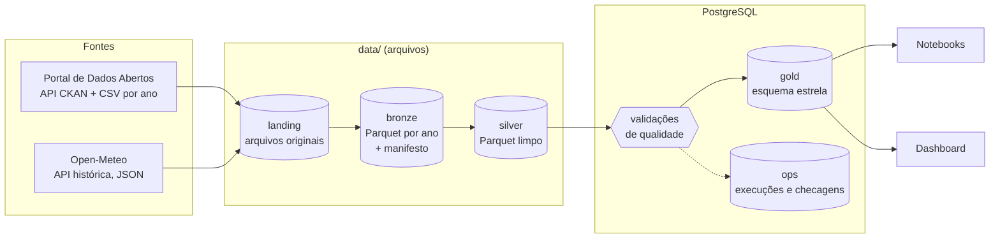
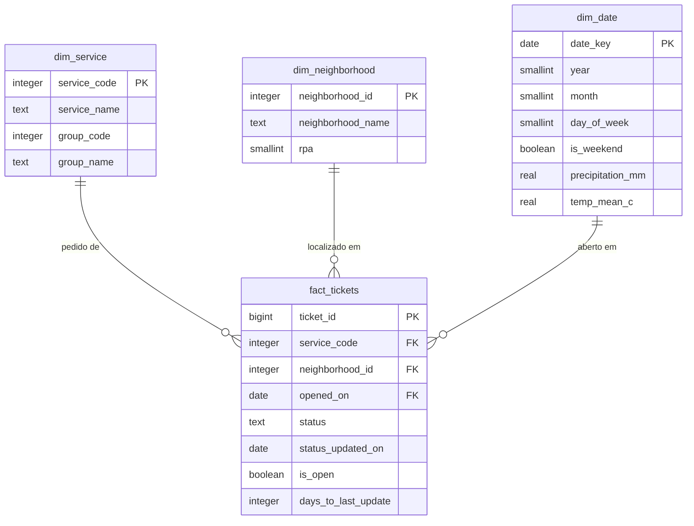

# Arquitetura

## Camadas de dados

| Camada | Onde | Formato | O que contém | Quem escreve |
|---|---|---|---|---|
| Landing | `data/raw` | CSV e JSON originais | Exatamente o que as fontes entregaram | `src/ingestion` |
| Bronze | `data/bronze/tickets/year=AAAA`, `data/bronze/weather/year=AAAA` | Parquet | Mesmo conteúdo, sem correções, mais `_source` e `_ingested_at` | `src/ingestion` com `src/layers/bronze.py` |
| Silver | `data/silver` | Parquet | Chamados limpos e deduplicados, clima tipado | `src/layers/silver.py` |
| Gold | PostgreSQL, schema `public` | Tabelas | Fato e dimensões, view do dashboard, índices | `src/transform/modeling.py`, `src/db/load.py` |
| Ops | PostgreSQL, schema `ops` | Tabelas | Histórico de execuções e de validações | `src/db/load.py` |

## Uma execução do pipeline

`python -m src.pipeline` (ou `make pipeline`) faz, nesta ordem:

1. Ingestão: consulta a API CKAN e o Open-Meteo. Para cada ano, compara a versão e o hash com o manifesto da bronze e só baixa e regrava o que mudou. Se o portal estiver fora do ar e a bronze já existir, segue com ela e registra um aviso.
2. Registro: abre uma linha em `ops.pipeline_runs` com o que mudou na ingestão.
3. Silver: lê toda a bronze, aplica a limpeza e grava os Parquet de silver.
4. Qualidade: roda as validações de `src/quality/checks.py` e grava cada resultado em `ops.quality_checks`. Uma falha de nível "error" interrompe a execução antes da gold.
5. Gold: recria o esquema estrela, carrega com `COPY` e cria os índices, tudo em uma transação.
6. Fecha o registro da execução com sucesso ou falha.

Rodar duas vezes seguidas não baixa nada na segunda vez e produz a mesma gold. `make refresh` ignora o manifesto e refaz tudo.

## Modelo da gold

O grupo de serviço fica dentro de `dim_service`, porque cada serviço pertence a um único grupo (uma validação garante isso), o que evita uma junção a mais em quase toda consulta. O clima é um atributo do dia, então mora em `dim_date`.

## Decisões registradas

- [ADR 0001: PostgreSQL como banco da camada gold](adr/0001-postgresql-como-banco-analitico.md)
- [ADR 0002: Camadas bronze, silver e gold](adr/0002-camadas-bronze-silver-gold.md)
- [ADR 0003: Parquet para bronze e silver](adr/0003-parquet-para-bronze-e-silver.md)
- [ADR 0004: Ingestão incremental, carga completa da gold](adr/0004-carga-completa-da-gold.md)
